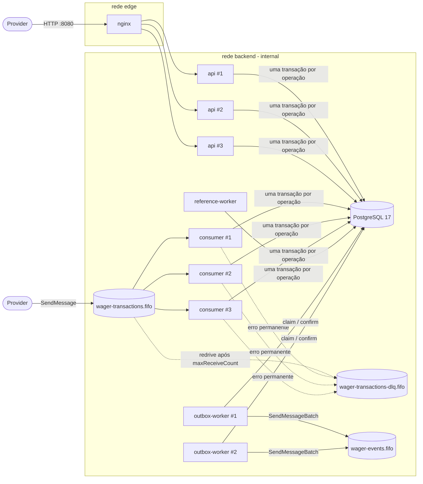
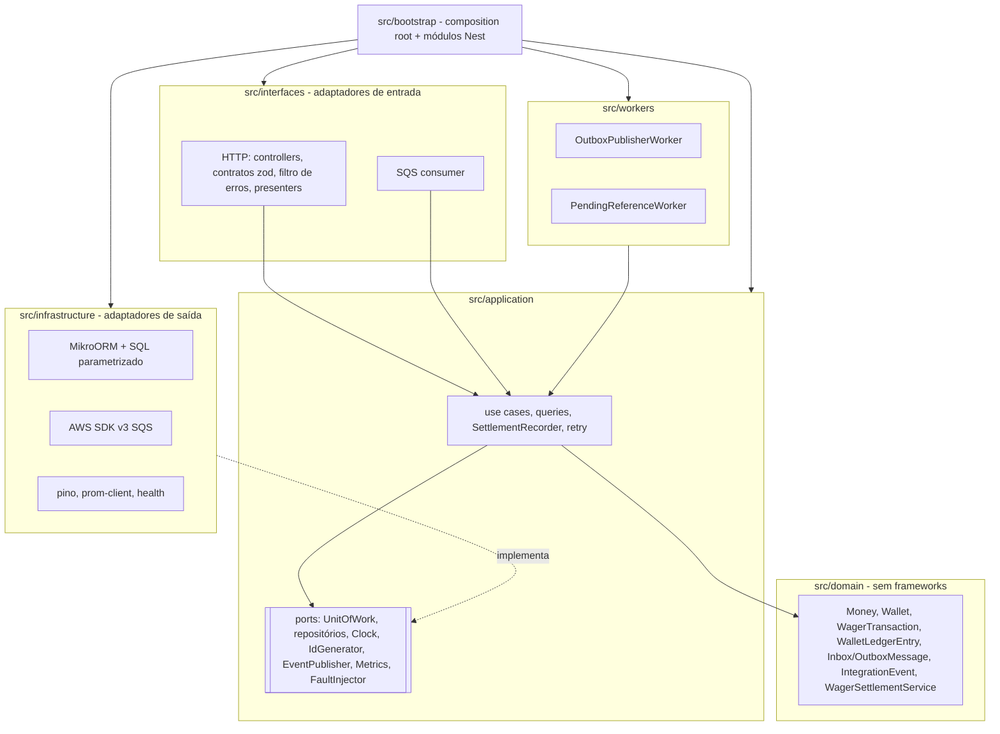
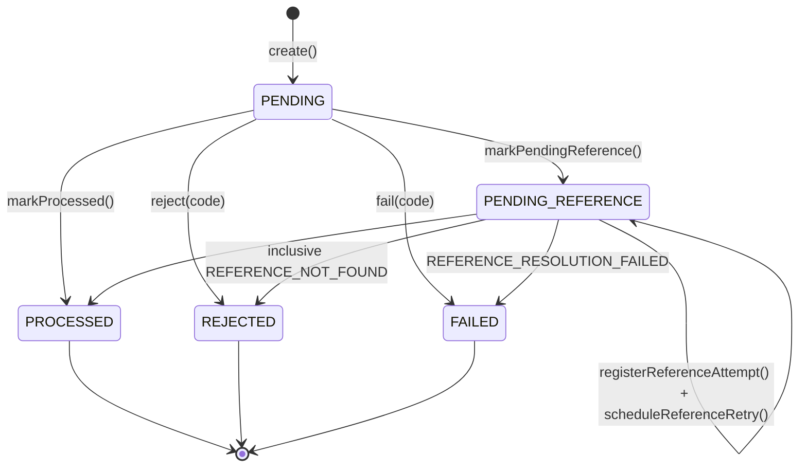

# Arquitetura — Distributed Wagering Processor

Este documento justifica as decisões técnicas da solução: o que foi escolhido, o que foi descartado, por quê, e quais as consequências e limitações. Cada afirmação aponta para o código ou para o teste que a comprova.

## Sumário

1. [Visão geral](#1-visão-geral)
2. [Modelo de domínio e regras](#2-modelo-de-domínio-e-regras)
3. [Schema: garantias aplicadas pelo PostgreSQL](#3-schema-garantias-aplicadas-pelo-postgresql)
4. [O caminho financeiro: uma transação SQL](#4-o-caminho-financeiro-uma-transação-sql)
5. [ADRs](#5-adrs) (ADR-001 a ADR-015)
6. [Diagramas de sequência](#6-diagramas-de-sequência)
7. [Matriz de falhas](#7-matriz-de-falhas)
8. [Interpretações e hipóteses adotadas](#8-interpretações-e-hipóteses-adotadas)
9. [Limitações conhecidas](#9-limitações-conhecidas)
10. [Escolha de versões](#10-escolha-de-versões)

---

## 1. Visão geral

Um **monólito modular** implantado como **vários processos independentes**, todos sobre o **mesmo PostgreSQL**. Uma única imagem Docker com seis entrypoints:



| Processo | Entrypoint | Réplicas | Responsabilidade |
|---|---|---|---|
| `api` | `src/entrypoints/api.ts` | 3 | REST, health, métricas. Não roda workers. |
| `consumer` | `src/entrypoints/consumer.ts` | 3 | Consome `wager-transactions.fifo` com o **mesmo use case** da API. |
| `outbox-worker` | `src/entrypoints/outbox-worker.ts` | 2 | Publica eventos confirmados em `wager-events.fifo`. |
| `reference-worker` | `src/entrypoints/reference-worker.ts` | 1 (seguro com N) | Reprocessa `PENDING_REFERENCE`. |
| `migrations` | `src/entrypoints/migrate.ts` | job | Migrations versionadas + provisionamento do login de runtime. |
| `queue-bootstrap` | `src/entrypoints/bootstrap-queues.ts` | job | Criação idempotente das filas FIFO e da DLQ. |

### Camadas (hexagonal)



As fronteiras são **verificadas pelo lint** (`eslint.config.mjs`, regra `no-restricted-imports`): o domínio não pode importar NestJS, MikroORM, AWS SDK, pino, prom-client nem camadas externas; a aplicação não pode importar adaptadores.

---

## 2. Modelo de domínio e regras

### Agregados e value objects (`src/domain`)

| Classe | Papel | Garantias encapsuladas |
|---|---|---|
| `Money` | value object imutável (`Object.freeze`) | `decimal.js`, escala fixa 2, ISO-4217 com 2 casas, rejeita `NaN`/`Infinity`/notação científica/sinal/zeros à esquerda/>2 casas sem arredondar, overflow além de `NUMERIC(20,2)`, operações e comparações só com a mesma moeda. `from` (contrato de entrada, não negativo) × `fromSigned` (diferenças internas). |
| `Wallet` | aggregate root | saldo só muda por `debit`/`credit`; cada mudança devolve **exatamente um** `WalletLedgerEntry` com a nova versão; versão começa em 1 e só incrementa quando o saldo muda; saldo nunca negativo; moeda única. |
| `WalletLedgerEntry` | entidade imutável | sem setters nem transições; `create` prova `balanceAfter = balanceBefore ± amount`; valor positivo; mesma moeda. |
| `WagerTransaction` | entidade com máquina de estados explícita | identidade e conteúdo financeiro `readonly`; transições permitidas em tabela; estados terminais sem saída; `OPENING` só pelo canal interno; referência obrigatória para REFUND/ROLLBACK e proibida para BET. |
| `InboxMessage` / `OutboxMessage` | registros de mensageria | inbox `PROCESSED` é final; outbox com tentativas, backoff e retenção `DEAD`. |
| `IntegrationEvent<T>` | envelope abstrato | `eventType` e `version` definidos na subclasse; `data` com dinheiro em string decimal. Subclasses: `WagerTransactionProcessed`, `WagerTransactionRejected`, `WagerTransactionFailed`, `WagerTransactionPendingReference`, `WalletBalanceChanged`. |
| `WagerSettlementService` | serviço de domínio | **todas** as regras financeiras, num único método `settle()` usado por HTTP, SQS e worker. |

Todas as classes usam construtor privado + factories estáticas (`create`/`open`/`enqueue`/`receive`) e `rehydrate`, que reconstrói o estado persistido **sem** reaplicar regras de transição.

### Máquina de estados de `WagerTransaction`



`PENDING` só existe em memória durante a transação SQL: a decisão é tomada antes do commit, e por isso nunca há linha `PENDING` persistida. Transições a partir de estados terminais lançam `InvalidTransactionStateError` (erro de programação). O mesmo é imposto pelo trigger `wager_transactions_guard` no banco.

### Regras financeiras (`WagerSettlementService.settle`)

Ordem de avaliação, sob o lock da wallet:

1. jogador ≠ dono da wallet → `REJECTED PLAYER_WALLET_MISMATCH`;
2. moeda ≠ moeda da wallet → `REJECTED CURRENCY_MISMATCH`;
3. se há referência:
   - ausente ou ainda não terminal → `PENDING_REFERENCE`;
   - referência `REJECTED`/`FAILED` → `REJECTED REFERENCE_NOT_PROCESSED`;
   - outro provider/jogador/wallet/moeda/rodada → `REJECTED REFERENCE_MISMATCH`;
   - tipo não permitido (REFUND→só BET; ROLLBACK→BET/WIN/REFUND; WIN/LOSS→BET) → `REJECTED REFERENCE_KIND_NOT_ALLOWED`;
   - reversão com valor diferente → `REJECTED REVERSAL_AMOUNT_MISMATCH`;
   - referência já revertida com sucesso (REFUND **ou** ROLLBACK) → `REJECTED REFERENCE_ALREADY_REVERSED`;
4. LOSS → `PROCESSED` sem ledger, sem mudar versão;
5. direção: BET débito; WIN/REFUND crédito; ROLLBACK inverte a referência (de BET credita; de WIN/REFUND debita);
6. débito sem saldo → `REJECTED INSUFFICIENT_FUNDS` (BET) ou `REVERSAL_INSUFFICIENT_FUNDS` (ROLLBACK);
7. crédito que excederia `NUMERIC(20,2)` → `REJECTED BALANCE_LIMIT_EXCEEDED`;
8. caso contrário `PROCESSED` com exatamente um lançamento.

Testes: `test/unit/domain/wager-settlement.test.ts` (regras), `test/integration/wager-processing.test.ts` (com banco real).

### Taxonomia de `failureCode` (persistida, estável)

| Código | Status | Significado | O provider deve |
|---|---|---|---|
| `INSUFFICIENT_FUNDS` | REJECTED | BET maior que o saldo | não reenviar a mesma operação |
| `REVERSAL_INSUFFICIENT_FUNDS` | REJECTED | ROLLBACK de WIN/REFUND deixaria saldo negativo | escalar operacionalmente (situação diferente de aposta sem saldo) |
| `CURRENCY_MISMATCH` | REJECTED | moeda ≠ moeda da wallet | corrigir o payload (nova `externalTransactionId`) |
| `PLAYER_WALLET_MISMATCH` | REJECTED | jogador não é dono da wallet | corrigir o payload |
| `REFERENCE_NOT_FOUND` | REJECTED | referência não apareceu dentro do limite de tentativas/TTL | investigar a ordem de envio |
| `REFERENCE_MISMATCH` | REJECTED | referência de outro jogador/wallet/moeda/rodada | corrigir o payload |
| `REFERENCE_KIND_NOT_ALLOWED` | REJECTED | ex.: REFUND de WIN | corrigir o payload |
| `REFERENCE_NOT_PROCESSED` | REJECTED | referência terminou REJECTED/FAILED | nada a reverter |
| `REFERENCE_ALREADY_REVERSED` | REJECTED | a referência já tem um REFUND/ROLLBACK bem-sucedido | não reenviar |
| `REVERSAL_AMOUNT_MISMATCH` | REJECTED | reversão parcial (fora de escopo) | enviar o valor integral |
| `BALANCE_LIMIT_EXCEEDED` | REJECTED | crédito excederia a precisão suportada | escalar |
| `REFERENCE_RESOLUTION_FAILED` | FAILED | erros inesperados repetidos ao resolver a referência | escalar (auditável, terminal) |

Erros que **não** geram transação persistida usam códigos de erro HTTP (ADR-012).

---

## 3. Schema: garantias aplicadas pelo PostgreSQL

As migrations ficam em [`migrations/`](migrations/) e são versionadas e reversíveis (`up`/`down`), testadas em PostgreSQL real em `test/integration/migrations.test.ts`. O teste `test/integration/schema-guarantees.test.ts` **ataca o schema diretamente via SQL**, como owner e como login de runtime, e espera que o banco recuse cada violação.

### Tabelas

| Tabela | Chave | Papel |
|---|---|---|
| `wallets` | `id` | saldo materializado (`NUMERIC(20,2)`), `version` |
| `wager_transactions` | `id` | operações + idempotência + snapshot do resultado + agendamento de referências |
| `wallet_ledger_entries` | `id` | ledger append-only, uma linha por versão da wallet |
| `inbox_messages` | `(consumer_name, message_id)` | deduplicação de mensagens |
| `outbox_messages` | `id` (= eventId), `seq` identity | eventos a publicar |

### Constraints declarativas (migration `…0100`, `…0200`)

| Garantia | Constraint |
|---|---|
| 1 wallet por jogador+moeda | `wallets_player_currency_uq` |
| Saldo nunca negativo | `wallets_balance_non_negative_ck`, `ledger_balances_non_negative_ck`, `wager_tx_result_balance_non_negative_ck` |
| Idempotência por provider | `wager_tx_provider_idempotency_key_uq (provider_id, idempotency_key)` |
| Operação externa única por provider | `wager_tx_provider_external_id_uq (provider_id, external_transaction_id)` |
| Uma linha de ledger por transação | `ledger_transaction_uq (transaction_id)` |
| Uma linha por versão da wallet (e índice de paginação keyset) | `ledger_wallet_version_uq (wallet_id, wallet_version)` |
| Aritmética do lançamento | `ledger_arithmetic_ck`: `CREDIT ⇒ after = before + amount`; `DEBIT ⇒ after = before − amount` |
| Lançamento = valor, moeda e wallet da transação | FK composta `ledger_transaction_fk (transaction_id, wallet_id, currency, amount) → wager_transactions` |
| Moeda do lançamento = moeda da wallet | FK composta `ledger_wallet_fk (wallet_id, currency) → wallets` |
| Referência só na mesma wallet | FK composta `wager_tx_reference_same_wallet_fk (reference_transaction_id, wallet_id)` |
| No máximo **uma reversão bem-sucedida** por referência | índice único parcial `wager_tx_single_successful_reversal_uq (reference_transaction_id) WHERE status='PROCESSED' AND kind IN ('REFUND','ROLLBACK')` |
| Mensagem única por consumidor | `inbox_messages_pk (consumer_name, message_id)` |
| Coerência de status | `failure_code` ⇔ REJECTED/FAILED; `processed_at` ⇔ terminal; snapshot obrigatório fora de PENDING; agenda obrigatória em PENDING_REFERENCE; claim só em estados não terminais |
| OPENING só interno | `wager_tx_opening_internal_ck ((kind='OPENING') = (channel='INTERNAL'))` |
| Valores positivos (exceto LOSS) | `wager_tx_amount_positive_ck`, `ledger_amount_positive_ck` |

As FKs são `DEFERRABLE INITIALLY DEFERRED`: continuam sendo verificadas, mas no COMMIT, o que libera a ordem dos INSERTs dentro da transação financeira.

### Triggers (migration `…0300`)

Regras entre linhas que um `CHECK` não expressa:

| Trigger | Quando | Garante |
|---|---|---|
| `wallet_ledger_entries_append_only` / `_no_truncate` | UPDATE/DELETE/TRUNCATE | ledger imutável **inclusive para o owner** |
| `wallet_ledger_entries_validate` (constraint trigger, diferido) | INSERT, no COMMIT | encadeamento (`balance_before` = `balance_after` da versão anterior, versões contíguas, primeira linha parte de zero); existe mudança de saldo correspondente na wallet; transação `PROCESSED`; direção coerente com o tipo (LOSS nunca move dinheiro; ROLLBACK inverte a referência) |
| `wallets_guard` | INSERT/UPDATE | identidade imutável; versão inicial 1; `balance` muda ⇔ `version` +1 exato |
| `wallets_balance_change_has_ledger_entry` (diferido) | INSERT/UPDATE, no COMMIT | todo novo `(version, balance)` tem a linha de ledger com esse `balance_after` |
| `wager_transactions_processed_has_ledger_entry` (diferido) | INSERT/UPDATE OF status | toda transação `PROCESSED` que move dinheiro tem sua linha de ledger |
| `wager_transactions_guard` | UPDATE/DELETE/TRUNCATE | estados terminais imutáveis; identidade e conteúdo financeiro imutáveis; sem volta a PENDING; tentativas monotônicas; transações nunca apagadas |
| `wager_transactions_validate_reference` | INSERT/UPDATE para PROCESSED | referência existe, está PROCESSED, é do mesmo provider/jogador/wallet/moeda/rodada, de tipo permitido e (em reversões) do mesmo valor |
| `inbox_messages_guard` / `outbox_messages_guard` | UPDATE | inbox `PROCESSED` e outbox `PUBLISHED` imutáveis; conteúdo do evento imutável |

Os erros levantam SQLSTATE 23514/23000 com `CONSTRAINT = <nome>`, e a aplicação os classifica como `IntegrityViolationError` (500, nunca retentado; ver `database-errors.ts`).

**Sobre a igualdade saldo = soma do ledger.** Um `CHECK` simples não pode comparar tabelas diferentes, e esta solução não afirma que comparar. A igualdade decorre de três mecanismos complementares:

1. **o protocolo transacional**: wallet e ledger são escritos no mesmo commit, sob o lock da wallet;
2. **os triggers diferidos**: cada versão da wallet tem exatamente um lançamento cujo `balance_after` é o saldo daquela versão, a cadeia de lançamentos é contínua desde zero e a aritmética de cada lançamento é verificada. Por indução, o saldo atual é igual à soma dos lançamentos **enquanto os triggers estiverem ativos**;
3. **a reconciliação** (`POST /wallets/:id/reconciliation`): verifica a igualdade de forma independente e detecta violações que contornem os triggers. Um superusuário pode desativá-los com `session_replication_role = replica`, e o teste `reconciliation.test.ts` faz exatamente isso para provar a detecção.

### Privilégios (migration `…0400`)

Os serviços conectam com um login membro do grupo `wagering_app`, que tem apenas `SELECT/INSERT` no ledger, `SELECT/INSERT/UPDATE` nas demais tabelas e **nenhum** `DELETE`/`TRUNCATE`. As migrations rodam como owner. O teste `the runtime login has no UPDATE/DELETE privilege` verifica a recusa com `42501`.

---

## 4. O caminho financeiro: uma transação SQL

`ProcessWagerTransactionUseCase` (HTTP e SQS) e `ResolvePendingReferenceUseCase` (worker) usam o mesmo `SettlementRecorder` e o mesmo serviço de domínio. Para uma operação nova, **um único COMMIT** contém:

1. `SELECT … FROM wallets WHERE id=$1 FOR UPDATE` (lock da linha da wallet);
2. inbox: verificação por `(consumer_name, message_id)`, quando a origem é SQS;
3. idempotência: busca por `(provider_id, idempotency_key)` e por `(provider_id, external_transaction_id)`;
4. busca da referência e de reversões já existentes (sob o mesmo lock);
5. decisão de domínio (status, saldo, lançamento);
6. INSERT da `wager_transactions` com o **snapshot do resultado** (`result_balance_amount`, `result_wallet_version`);
7. UPDATE da wallet (saldo + versão) e INSERT do lançamento, se houve efeito financeiro;
8. INSERT dos eventos no outbox;
9. INSERT/UPDATE da linha do inbox (SQS);
10. "despertar" dependentes `PENDING_REFERENCE` da mesma wallet (`next_attempt_at = now`);
11. `COMMIT`, quando os triggers diferidos e as FKs são verificados.

Nenhuma chamada de rede ao SQS acontece dentro dessa transação. Uma falha em qualquer etapa provoca ROLLBACK total, comprovado pelo teste `a failure after every write but before COMMIT leaves no partial state` com o fault point `wager.before-commit`.

**Ordem de locks** (fixa em todos os caminhos): linha da `wallet` → linha da `wager_transaction` (worker) → linhas inseridas/atualizadas. Toda operação toca **uma única wallet**, porque a referência precisa pertencer à mesma wallet (garantido no domínio e pela FK composta). Por isso não existe aquisição de locks de várias wallets, nem o ciclo clássico de deadlock entre wallets.

---

## 5. ADRs

### ADR-001 — Monólito modular em vez de microsserviços

**Contexto.** As invariantes centrais (saldo, ledger, idempotência, inbox, outbox) precisam ser confirmadas **atomicamente**.

**Decisão.** Um único deployable com módulos separados por camada e por responsabilidade, implantado como **vários processos** (API, consumidores, workers) sobre o **mesmo PostgreSQL**. Uma imagem, seis entrypoints.

**Alternativas descartadas.** Microsserviços por entidade (wallet, transaction, ledger): exigiriam transações distribuídas (2PC) ou sagas com compensação para o que hoje é um COMMIT. Isso troca uma garantia forte por consistência eventual exatamente onde ela não é aceitável.

**Consequências.** Atomicidade trivial e verificável; código compartilhado entre entradas (HTTP/SQS/worker); escala horizontal por tipo de processo (`--scale`). O limite é o banco único (ADR-003). A **extração futura** é possível porque as fronteiras já existem: o outbox (`wager-events.fifo`) é a interface natural para extrair leitura/projeções, notificações ou relatórios sem tocar no núcleo financeiro.

### ADR-002 — DDD + Hexagonal

**Decisão.** Domínio puro (`src/domain`) com agregados que encapsulam as invariantes; aplicação (`src/application`) com use cases e **portas** (`UnitOfWork`, repositórios, `Clock`, `IdGenerator`, `EventPublisher`, `WageringMetrics`, `FaultInjector`); adaptadores em `src/infrastructure` (saída) e `src/interfaces` (entrada); composição em `src/bootstrap`.

- **Agregado `Wallet`**: única porta de mudança do saldo, e cada mudança devolve o lançamento. Como o saldo e o ledger nascem juntos, não é possível alterar um sem o outro dentro do domínio.
- **Por que o domínio não depende do NestJS.** As regras financeiras são o ativo mais crítico e o que mais precisa de teste: os 143 testes unitários rodam em menos de 2s, sem framework. Frameworks mudam de versão major (NestJS 12 e MikroORM 7 saíram em 2026), e o domínio fica imune a isso. Os use cases também não usam decorators: o Nest só **expõe** os objetos já construídos (`CoreModule.register`), e testes de integração usam o mesmo composition root (`createCore`) sem Nest.
- **Dependências permitidas** (verificadas por lint): domínio → nada externo (só `decimal.js`, que é uma biblioteca pura); aplicação → domínio e portas; adaptadores → tudo.
- **Evitado de propósito**: interface para cada classe, camadas que só repassam chamadas, mediator/CQRS genérico. Há portas apenas onde existe mais de uma implementação real (testes × produção) ou onde há fronteira de I/O.

### ADR-003 — PostgreSQL como fonte da verdade

**Decisão.** O saldo materializado, o ledger, a idempotência, o inbox e o outbox vivem no PostgreSQL. Não há cache nem estado em memória que participe de alguma decisão.

**Por quê.** ACID real: as escritas do caminho financeiro estão no mesmo COMMIT (seção 4). O isolamento é `READ COMMITTED` mais o lock de linha. Depois de adquirir o lock, cada `SELECT` vê os commits anteriores, então as verificações de idempotência e de saldo valem para o estado mais recente. A reconciliação usa `REPEATABLE READ READ ONLY` para ler wallet e ledger do **mesmo snapshot**, sem falsos alarmes sob escrita concorrente (teste `concurrent movements never produce a false divergence`). As constraints e os triggers da seção 3 tornam as invariantes independentes da aplicação.

**Limitações de um banco único.** É ponto único de falha (mitigável com réplica síncrona + failover gerenciado). O throughput de escrita é limitado a uma instância primária, e cada wallet é serializada (ADR-005). Particionar por wallet (sharding) seria o próximo passo, compatível com o modelo porque toda operação toca uma única wallet.

### ADR-004 — Money e precisão decimal

**Decisão.** `Money` usa `decimal.js` (clone com 40 dígitos de precisão, bem acima do `NUMERIC(20,2)`, de modo que somas e subtrações são exatas). Entrada e saída são **strings** com escala fixa 2 (`"25.00"`), e a persistência usa `NUMERIC(20,2)` em colunas separadas de moeda, que o driver `pg` devolve como **texto**. Nenhum `number` toca dinheiro em nenhuma camada.

- **Por que nunca float.** `0.1 + 0.2 ≠ 0.3` em IEEE-754, e o erro acumula. Os testes `0.10 + 0.20 is exactly 0.30` e `large values keep every cent` (18 dígitos inteiros) cobrem isso.
- **Sem arredondamento implícito.** Entradas com mais de duas casas são **rejeitadas** (`25.001` → 400). Arredondar silenciosamente mudaria valores apostados.
- **Validação em camadas.** O contrato zod (formato) e o `Money.from` (formato + moeda + faixa) validam a entrada. O banco aplica `NUMERIC(20,2)` e os `CHECK`s.
- **Defesa extra.** `bun run check:money` usa o type checker do TypeScript para falhar o build se houver `parseFloat`, propriedades monetárias tipadas como `number`, aritmética com `number` em nomes monetários, `.toFixed` fora do `Money`, ou colunas `float/real/double/money` ou monetárias que não sejam `NUMERIC(20,2)`. Verifiquei com uma sonda contendo violações propositais que o check falha como esperado.
- **Multi-moeda.** O domínio aceita moedas ISO-4217 com 2 casas decimais (BRL, USD, EUR…). A API aceita as de `ACCEPTED_CURRENCIES` (padrão `BRL`) para criar wallets. Conflitos de moeda são testados.

### ADR-005 — Concorrência por wallet: lock pessimista de linha

**Decisão.** A unidade de concorrência é a `walletId`. Cada operação adquire `SELECT … FOR UPDATE` na linha da wallet (MikroORM `LockMode.PESSIMISTIC_WRITE`), dentro de `em.transactional()`, e só então lê, decide e escreve. Antes, um *probe* com `FOR UPDATE SKIP LOCKED` (`PESSIMISTIC_PARTIAL_WRITE`) detecta, sem custo extra quando não há disputa, se a linha estava travada. Isso alimenta `wagering_wallet_lock_contention_total`.

**Por que não optimistic locking com retry.** Numa hot wallet, otimista significa ler, calcular, falhar na escrita e tentar de novo, com custo crescente e risco de esgotar retries sob disputa. O pessimista transforma disputa em fila ordenada, com espera limitada por `lock_timeout`.

**Por que não mutex em memória.** Não funciona com várias instâncias e é perdido num crash. O teste `across three independent API processes` prova a correção entre processos de sistema operacional distintos.

**Por que não lock global.** Serializaria todas as wallets. O teste `different wallets never block each other` mostra que uma wallet travada não atrasa outra.

**Limites de espera.** Cada conexão é configurada com `lock_timeout=5s`, `statement_timeout=15s` e `idle_in_transaction_session_timeout=30s` (`orm.ts`). Transações curtas: só SQL, sem I/O externo.

**Deadlocks e retries.** Deadlock (`40P01`), falha de serialização (`40001`), lock timeout (`55P03`) e corrida em constraint única (`23505`) são erros **transitórios**. O `TransactionRetryExecutor` reexecuta a **unidade de trabalho inteira** (até 4 tentativas, backoff exponencial com jitter), recomeçando pela verificação de idempotência. Assim um retry nunca aplica uma operação duas vezes. O teste `a provoked deadlock is detected by PostgreSQL, retried from scratch and applied exactly once` cria um ciclo real e prova que o efeito é único.

> **Lição registrada.** `lock_timeout` precisa ser maior que `deadlock_timeout` (1s). Caso contrário, uma espera que formaria um deadlock termina antes como *lock timeout*. Continua correto (também é transitório e reexecutado), mas o deadlock deixa de aparecer como tal nas métricas.

**Hot wallets: trade-off medido** ([docs/LOAD_TEST.md](docs/LOAD_TEST.md)). Com 15% do tráfego numa única wallet, ela atinge p50 de ~535ms, porque cada commit espera o anterior. Quem espera o lock **segura uma conexão do pool**, o que eleva a cauda de latência das demais wallets (p95 616ms × 184ms sem hot wallet). Mitigações, não necessárias para a correção: fila em memória por wallet em cada instância (*single-flight*, reduz conexões ociosas sem substituir o lock), pool dedicado, `lock_timeout` menor para falhar cedo com `503 LOCK_TIMEOUT`, ou sub-wallets.

**Timestamps após o lock.** O instante da decisão é capturado **depois** do lock. Antes, uma versão N+1 podia ter timestamp anterior ao da versão N. O teste de carga revelou isso, e toda suíte agora verifica que o ledger é não-decrescente no tempo por versão. Contra pequenas diferenças de relógio entre instâncias, o `Wallet` também nunca data um movimento antes do anterior: usa o maior entre o "agora" da instância e o `updatedAt` atual. Isso preserva `updated_at >= created_at` e a ordem temporal do ledger.

### ADR-006 — Idempotência persistente

**Decisão.** A própria linha de `wager_transactions` é o registro de idempotência, protegido por duas constraints únicas por provider: `(provider_id, idempotency_key)` e `(provider_id, external_transaction_id)`. O resultado original fica na mesma linha (`status`, `failure_code`, `result_balance_amount`, `result_wallet_version`, `processed_at`), gravado no mesmo commit do efeito financeiro.

- **Hash canônico.** `payloadHash = SHA-256(hex)` do JSON canônico (chaves ordenadas, sem espaços, opcionais ausentes omitidos, valor normalizado por `Money`) **somente** dos campos de negócio: `providerId, externalTransactionId, playerId, walletId, roundId, gameId, kind, money{amount,currency}, referenceExternalTransactionId`. O header `Idempotency-Key`, o envelope SQS e qualquer metadado de transporte ficam fora. Por isso HTTP e SQS produzem o mesmo hash (`payload-hash.ts`, com vetor de teste fixo).
- **Comportamentos.**

  | Situação | Resultado |
  |---|---|
  | mesma chave + mesmo hash | **replay**: devolve o snapshot original (`idempotentReplay: true`) |
  | mesma chave + hash diferente | `409 IDEMPOTENCY_KEY_CONFLICT`, sem efeito |
  | mesmo `externalTransactionId`, outra chave | `409 DUPLICATE_EXTERNAL_TRANSACTION`, sem efeito |
  | HTTP e depois SQS (ou o inverso) da mesma operação | o segundo é replay; um único efeito |

- **Saldo histórico.** O replay devolve o saldo **observado na operação original**, não o atual. O teste `identical replay returns the ORIGINAL result, including the historical balance` faz BET (saldo 80), depois WIN e outra BET, repete a BET e verifica 80.00.
- **Replay enquanto pendente.** Se a operação original está `PENDING_REFERENCE`, o replay devolve `202` com o estado atual. Quando ela é liquidada pelo worker, o replay passa a devolver o resultado terminal, que a partir daí é imutável.
- **Corridas.** Requisições simultâneas da mesma operação serializam no lock da wallet. A segunda, depois do lock, vê o commit da primeira e vira replay. Se duas requisições com a mesma chave apontarem para wallets **diferentes** (payload divergente), não há lock em comum. Nesse caso a constraint única decide: a perdedora recebe `23505`, o executor reexecuta a unidade e ela passa a ver a linha vencedora (→ `409`). Os testes `50 parallel calls`, `50 parallel HTTP requests spread over 3 API processes` e `HTTP (3 instances) AND SQS (3 consumer processes) at the same time` provam um único débito.
- **Por que não cache em memória.** Restrição do desafio, e incorreto com várias instâncias e crashes.

### ADR-007 — Ledger imutável, de entrada única

**Decisão.** Ledger de entrada única: cada mudança de saldo gera uma linha com direção, valor, saldo anterior, saldo posterior e versão da wallet. É append-only no domínio (sem métodos de mutação), no repositório (só `append`), nos privilégios (sem UPDATE/DELETE) e nos triggers (nem o owner altera).

- **Auditoria.** A linha guarda `balance_before`, `balance_after` e `wallet_version`: qualquer saldo histórico é reconstituível e verificável linha a linha, sem refazer somas.
- **Reversões por compensação.** REFUND e ROLLBACK geram **novos** lançamentos. Nada é apagado nem editado.
- **Partidas dobradas.** É diferencial opcional e não foi implementado. O desenho permite acrescentá-lo (contas de contrapartida "casa"/"provider") sem mudar o protocolo.
- **Limitação das constraints entre tabelas.** Ver a nota em §3: a igualdade saldo = soma vem de protocolo + triggers diferidos + reconciliação, não de um `CHECK`.

### ADR-008 — Inbox

**Decisão.** Tabela `inbox_messages` com chave `(consumer_name, message_id)` (o `messageId` do envelope), escrita **na mesma transação** do efeito financeiro, com o resultado (`outcome`: APPLIED, REPLAYED, CONFLICT, WALLET_NOT_FOUND, REJECTED; `transaction_id`; `result_code`) e o hash do payload.

- **Garantia real.** O efeito financeiro e o registro "mensagem processada" são atômicos: ou os dois existem, ou nenhum. Uma reentrega encontra o inbox e é respondida sem reprocessar (`DUPLICATE_MESSAGE` → ack). O mesmo `messageId` com outro payload vai para a DLQ (`MESSAGE_ID_CONFLICT`).
- **Ack depois do commit.** `DeleteMessage` só é chamado depois do COMMIT. Se o processo morrer entre os dois, a mensagem volta após o *visibility timeout* e o inbox a absorve. O teste `consumer killed AFTER the commit and BEFORE the ack` mata o processo com SIGKILL nesse ponto exato e verifica um único débito e `wagering_inbox_duplicates_total = 1` no novo consumidor.
- **Falha no DeleteMessage.** É registrada (`wagering_sqs_delete_failures_total`) e tratada igual ao caso anterior.
- **Escopo.** O inbox deduplica **mensagens**; a idempotência de negócio (ADR-006) deduplica **operações**. Mensagens diferentes com a mesma operação viram replays, cada uma com sua linha no inbox.

### ADR-009 — Transactional Outbox

**Decisão.** Os eventos são inseridos em `outbox_messages` **no mesmo commit** da operação. Publishers independentes (2 réplicas) fazem:

1. **claim** numa transação curta: `WITH due AS (SELECT … WHERE status='PENDING' AND next_attempt_at <= now AND (claim_expires_at IS NULL OR claim_expires_at < now) ORDER BY seq LIMIT n FOR UPDATE SKIP LOCKED) UPDATE … SET claimed_by, claim_expires_at = now + lease, attempts = attempts + 1`, seguido de **COMMIT**;
2. **publicação** no SQS **sem nenhuma transação ou lock aberto** (`SendMessageBatch`, `MessageDeduplicationId = eventId`, `MessageGroupId = walletId`);
3. **confirmação** em outra transação curta: `PUBLISHED`, independente de quem detém o lease, porque a publicação já aconteceu. Nas falhas, `next_attempt_at` com backoff exponencial e jitter persistido, condicionado a ainda ser o dono do lease. Após `OUTBOX_MAX_ATTEMPTS` (15) o evento fica `DEAD`: retido para intervenção, nunca descartado (alerta `OutboxDeadEvents`).

- **SKIP LOCKED + lease.** Publishers concorrentes pegam lotes disjuntos (teste `two concurrent publishers: … every event published exactly once`, com 60 eventos). O lease sobrevive ao commit do claim. Se o publisher morre, o lease expira e outro assume.
- **At-least-once, não exactly-once.** O teste `outbox publisher killed AFTER publishing and BEFORE confirming` mata o processo nesse ponto: o evento está no SQS e o banco ainda diz `PENDING`. Após o lease, outro publisher republica com o **mesmo eventId**. Dentro da janela de deduplicação do SQS FIFO (5 min) a cópia é descartada; fora dela, o consumidor deduplica por `eventId`, demonstrado com o próprio mecanismo de inbox (`downstream-projection`). Um evento confirmado **nunca** é perdido.
- **Nunca antes do commit.** Uma falha antes do COMMIT não deixa evento nenhum (teste `events are never visible before the financial commit`).
- **Ordenação.** Com publishers concorrentes, eventos de uma mesma wallet em lotes diferentes podem chegar fora de ordem. Os eventos trazem `walletVersion` e `occurredAt` para o consumidor ordenar ou descartar versões antigas. Ordenação estrita exigiria "um evento em voo por grupo", com *head-of-line blocking*, e não foi adotada.

### ADR-010 — SQS FIFO

**Decisão.** Filas `wager-transactions.fifo` (com `RedrivePolicy` → `wager-transactions-dlq.fifo`, `maxReceiveCount=5`) e `wager-events.fifo`, criadas de forma idempotente pelo job `queue-bootstrap` (`DeduplicationScope=messageGroup`, `FifoThroughputLimit=perMessageGroupId`). O `MessageGroupId` recomendado é o `walletId`.

- **Ordenação por wallet** reduz contenção e preserva a ordem do provider dentro da wallet. O consumidor processa mensagens do mesmo grupo **em sequência** e grupos diferentes **em paralelo**. Se uma mensagem do grupo falha, as seguintes do mesmo lote são adiadas para manter a ordem.
- **O banco continua sendo a garantia.** FIFO e deduplicação do SQS são **otimizações**: a deduplicação vale só por 5 minutos e por `MessageDeduplicationId`, e não protege de reentregas após o visibility timeout nem de produtores que geram ids diferentes. Os testes enviam deliberadamente a mesma mensagem com ids de deduplicação diferentes, e o inbox/idempotência mantém um único efeito.
- **Classificação de erros no consumidor.**

  | Classe | Exemplo | Ação |
  |---|---|---|
  | negócio | REJECTED, conflito, wallet inexistente | registra no inbox, **ack** |
  | transitório | `DATABASE_UNAVAILABLE`, `LOCK_TIMEOUT` | **sem ack**; `ChangeMessageVisibility` com backoff exponencial + jitter (1s → 60s); após `maxReceiveCount` o SQS move para a DLQ |
  | permanente | JSON inválido, contrato violado (ex.: `kind: OPENING`), `messageId` reutilizado | envio **explícito** para a DLQ (com motivo nos atributos) + linha `DEAD_LETTERED` no inbox, se possível |
  | inesperado | bug | retry até a última tentativa, depois DLQ (`PROCESSING_FAILED`) |

- **Queda do banco não esgota tentativas.** No primeiro `DATABASE_UNAVAILABLE` o consumidor **pausa o consumo** (métrica `wagering_sqs_consumer_paused = 1`) e sonda o PostgreSQL (`SELECT 1`) com backoff até 5s. Só volta a buscar mensagens quando o banco responde. Sem isso, com `maxReceiveCount=5` e backoff de 1s a 60s, uma queda de ~30s mandaria a mensagem da cabeça de cada grupo para a DLQ, e o grupo FIFO desbloqueado deixaria passar as mensagens seguintes (um REFUND, por exemplo) fora de ordem. Teste: `a database outage longer than the retry budget pauses consumption instead of dead-lettering`. Erros transitórios **por wallet** (como `LOCK_TIMEOUT`) não pausam o consumidor e seguem o redrive normal.
- **Visibilidade.** O *visibility timeout* é configurável (30s). Um heartbeat estende a visibilidade a cada metade do timeout enquanto a mensagem é processada.
- **Shutdown gracioso.** No SIGTERM o consumidor para de buscar, conclui as mensagens em andamento e devolve imediatamente (`VisibilityTimeout=0`) as recebidas e não iniciadas. **O long poll em curso não é abortado**: abortar um `ReceiveMessage` que o SQS já respondeu torna as mensagens invisíveis e consome uma de suas tentativas sem que ninguém as processe. Os testes de integração detectaram exatamente esse defeito numa versão anterior (mensagens indo para a DLQ antes da hora), e a correção reduziu de ~6s para ~1s o tempo dos testes do consumidor. O long poll termina em até `WaitTimeSeconds` (20s), dentro do `stop_grace_period` de 30s.

### ADR-011 — Referências fora de ordem

**Decisão.** REFUND/ROLLBACK (e WIN/LOSS com referência) cuja referência não existe, ou ainda não está terminal, são **persistidos** como `PENDING_REFERENCE`, emitem `WagerTransactionPendingReference`, **não movimentam** a wallet e recebem `next_attempt_at` e `reference_expires_at`. O `PendingReferenceWorker`:

1. faz claim dos devidos com `FOR UPDATE SKIP LOCKED` + lease (transação curta);
2. para cada um, numa transação: lock da **wallet**, depois lock da **transação** (mesma ordem do caminho principal), confere se ainda está `PENDING_REFERENCE` e se está devida, e chama o **mesmo** `SettlementRecorder`/`WagerSettlementService` do fluxo normal.

- **Backoff.** `2s × 2^tentativas`, limitado a 5 min, até **10 tentativas** ou **TTL de 1h**, o que vier primeiro (com os padrões, as tentativas esgotam em ~18 min). Ao esgotar: `REJECTED REFERENCE_NOT_FOUND` + `WagerTransactionRejected`. Erros inesperados repetidos acabam como `FAILED REFERENCE_RESOLUTION_FAILED` (auditável, terminal). Tudo é configurável (`REFERENCE_*`) e testado com `Clock` injetável (`ManualClock`), sem esperas reais.
- **Reação imediata.** Quando a referência é liquidada, os dependentes da mesma wallet têm `next_attempt_at` antecipado para "agora" na mesma transação. O worker os resolve no próximo ciclo (~1s), sem esperar o backoff. Encadeamentos (ROLLBACK → REFUND → BET) resolvem em cascata.
- **Concorrência.** Várias instâncias são seguras: o claim distribui lotes disjuntos e a liquidação reconfere o status sob o lock. O teste `competing worker instances …` executa cada claim **duas vezes em paralelo** por instâncias diferentes e verifica exatamente 8 tentativas efetivas e 8 descartadas. Com 8 REFUNDs para a mesma BET, apenas 1 é aplicado e os outros 7 recebem `REFERENCE_ALREADY_REVERSED`.
- **Ambiguidade REFUND × ROLLBACK.** Ver §8: no máximo uma reversão bem-sucedida por transação, garantida também pelo índice único parcial.

### ADR-012 — HTTP e erros

**Decisão.** Formato único de erro `{ code, message, correlationId, retryable, details? }`, em que `code` e `retryable` são o contrato de máquina e `message` serve só para humanos. Mapeamento consistente em todos os endpoints (`http-errors.ts`):

| Status | Quando | `retryable` |
|---|---|---|
| `201` | transação PROCESSED na primeira vez; wallet criada | — |
| `200` | replay de PROCESSED; consultas; reconciliação | — |
| `202` | `PENDING_REFERENCE` (primeira vez ou replay); `Location` para consultar | — |
| `400` | payload/parâmetro inválido (`VALIDATION_ERROR`, `INVALID_MONEY`, `UNSUPPORTED_CURRENCY`…), JSON malformado, `Idempotency-Key` ausente | false |
| `403` | provider não autorizado (`PROVIDER_FORBIDDEN`, ponto de extensão de auth) | false |
| `404` | recurso inexistente (`WALLET_NOT_FOUND`, `TRANSACTION_NOT_FOUND`, `ROUTE_NOT_FOUND`) | false |
| `409` | `WALLET_ALREADY_EXISTS`, `IDEMPOTENCY_KEY_CONFLICT`, `DUPLICATE_EXTERNAL_TRANSACTION` (`details.existingTransactionId`) | false |
| `422` | rejeição de regra de negócio: `code = failureCode`, mais `transactionId`, `status`, `balance` e `idempotentReplay` | false |
| `500` | `FAILED` (terminal) ou erro inesperado/violação de integridade (sem detalhes internos) | false |
| `503` | `DATABASE_UNAVAILABLE`, `LOCK_TIMEOUT`, `CONCURRENCY_CONFLICT`, `STATEMENT_TIMEOUT`; header `Retry-After: 1` | **true** |

Repetir é **sempre seguro** por causa da idempotência. `retryable: true` indica que a repetição deve dar resultado diferente. Uma wallet inexistente numa transação gera `404` sem persistência, porque a FK exige a wallet. Pelo SQS o resultado fica registrado no inbox. O teste `PostgreSQL unavailable: 503 retryable + not ready (live stays up), then automatic recovery` bloqueia conexões ao banco de verdade.

### ADR-013 — Observabilidade e recuperação

- **Logs JSON** (pino) com `service`, `instanceId` e o contexto propagado por `AsyncLocalStorage`: `correlationId` (header `X-Correlation-Id` ou gerado, devolvido na resposta e nos eventos), `requestId`, `messageId`, `transactionId`, `walletId`, `providerId`. Corpos de requisição/mensagem nunca são logados, e chaves sensíveis são redigidas. Linhas de alerta carregam `alert` (`RECONCILIATION_DIVERGENCE`, `MESSAGE_DEAD_LETTERED`, `OUTBOX_EVENT_DEAD`).
- **Métricas Prometheus** (por instância, `/metrics`; bloqueado no nginx): transações por kind/status/canal, replays, conflitos, duplicatas do inbox, retries por motivo, espera e contenção de lock, lock timeouts, deadlocks, latência dos use cases e do HTTP, mensagens recebidas/ack/retry/DLQ, falhas de `DeleteMessage`, profundidade da DLQ, pendências e **lag** do outbox, eventos `DEAD`, atraso commit→publicação, backlog e **lag** de referências pendentes, reconciliações e divergências.
- **Health.** `/health/live` indica só que o processo responde. `/health/ready` verifica PostgreSQL (`SELECT 1`) e SQS (`GetQueueAttributes`) com timeout de 2s. Se o banco cai, a instância fica *not ready* (503) mas viva, sem reinício em loop, e volta sozinha.
- **Reconciliação** sob demanda, só leitura, `REPEATABLE READ`: compara saldo × Σ ledger, versão × última linha e a continuidade da cadeia. Divergências são logadas, contadas e alertadas, **nunca corrigidas automaticamente**.
- **Perfil `observability`.** Prometheus descobre cada réplica via DNS do Docker (verificado: 9 alvos `up`). Grafana vem com dashboard provisionado e regras de alerta (`infra/monitoring/prometheus/alerts.yml`).
- **Diagnóstico.** `correlationId` liga a requisição HTTP, os logs de todas as instâncias e os eventos publicados. O inbox registra o resultado de cada mensagem, e o outbox, as tentativas e o último erro.
- **OpenTelemetry/Jaeger.** Não incluídos: a auto-instrumentação do OTel depende de hooks de módulo do Node que não são confiáveis no Bun. O `correlationId` cobre a necessidade de rastreio deste escopo.

### ADR-014 — Docker e infraestrutura

- **Uma imagem** multi-stage (`infra/docker/Dockerfile`): `deps` (lockfile congelado) → `dev` (toolbox de testes) → `build` (`tsc`) → `prod-deps` → `runtime` (`oven/bun:1.4.3-slim`, usuário **não-root** `bun`, apenas `dist/` + dependências de produção).
- **API e workers separados.** Cada processo roda um único papel (sem workers escondidos dentro da API), o que permite escalar e dimensionar pools de conexão de forma independente (api 10, consumer 5, outbox 3, reference 3; `max_connections=200`).
- **Inicialização ordenada.** `postgres` e `localstack` healthy → jobs `migrations` e `queue-bootstrap` (`service_completed_successfully`) → `api`/workers (healthy via `/health/ready`) → `nginx`. `init: true` (sinais corretos), `stop_grace_period: 30s`, `restart: unless-stopped`.
- **Redes.** `edge` (nginx + api) e `backend` (`internal: true`: banco, broker, workers sem rota externa). Só o nginx publica porta (`8080`, ou `API_PUBLIC_PORT`).
- **nginx.** `server api:3000 resolve` com `resolver 127.0.0.11`: as réplicas são redescobertas a cada 5s, com round-robin (verificado: 3 `X-Instance-Id` distintos). `proxy_next_upstream` não reenvia POST. Header `X-Upstream-Addr`.
- **Reprodutibilidade.** Versões exatas no `package.json`, `bun.lock` com `--frozen-lockfile`, imagens com tag fixa, timezone UTC em todos os containers e em cada conexão PostgreSQL. Testes rodam sem Bun no host (`docker compose --profile tools run --rm toolbox …`).

### ADR-015 — Autenticação

**Decisão de escopo.** Autenticação não vale pontos e foi deixada como **ponto de extensão explícito**, sem implementação artesanal.

- **Ponto de extensão.** A porta `ProviderIdentityResolver` e o `ProviderAuthGuard` (`src/interfaces/http/auth/provider-identity.ts`) já são aplicados aos controllers. Cada endpoint de escrita e de consulta por provider chama `assertCanActFor(request, providerId)`. O adaptador local `NoopProviderIdentityResolver` aceita todos e **não é segurança**: o processo loga um aviso (`AUTH_MODE=none`) na inicialização.
- **Desenho de integração com OIDC (Keycloak/Zitadel).**
  1. Cada provider é um *client* confidencial no IdP (fluxo *client credentials*), com um claim `provider_id` (mapper no Keycloak).
  2. Um `OidcProviderIdentityResolver` valida o JWT Bearer: assinatura via JWKS (com cache e rotação), `iss`, `aud`, `exp`/`nbf` e algoritmos permitidos. Ele mapeia `provider_id` → `ProviderIdentity.providers`.
  3. O guard compara o `providerId` do payload com o da identidade (`403 PROVIDER_FORBIDDEN`).
  4. Health e `/metrics` continuam públicos internamente; o nginx já bloqueia `/metrics` na borda.
  5. Mensagens SQS são canal interno confiável (conforme o desafio). A identidade do provider na mensagem continua sujeita às validações de domínio (ex.: `PLAYER_WALLET_MISMATCH`, referência do mesmo provider).
  6. Em Compose, Keycloak entraria num perfil próprio, com realm importado na inicialização.

---

## 6. Diagramas de sequência

### 6.1 Processamento de BET (HTTP)

```mermaid
sequenceDiagram
    autonumber
    participant P as Provider
    participant N as nginx
    participant A as api (1 de 3)
    participant DB as PostgreSQL
    participant O as outbox-worker
    participant Q as wager-events.fifo
    P->>N: POST /wagering/transactions (Idempotency-Key)
    N->>A: round-robin
    A->>A: valida contrato (zod) e Money; calcula payloadHash
    A->>DB: BEGIN
    A->>DB: SELECT wallet FOR UPDATE
    A->>DB: busca por (provider, key) e (provider, externalId)
    A->>A: WagerSettlementService.settle → DEBIT, PROCESSED
    A->>DB: INSERT transação (+snapshot), UPDATE wallet, INSERT ledger, INSERT outbox ×2
    A->>DB: COMMIT (triggers diferidos verificam ledger ↔ wallet)
    A-->>P: 201 {status: PROCESSED, balance, idempotentReplay:false}
    O->>DB: claim (SKIP LOCKED + lease) e COMMIT
    O->>Q: SendMessageBatch (dedup = eventId, group = walletId)
    O->>DB: marca PUBLISHED
```

### 6.2 Requisições duplicadas simultâneas

```mermaid
sequenceDiagram
    autonumber
    participant R1 as requisição 1 (api #1)
    participant R2 as requisição 2 (api #2)
    participant DB as PostgreSQL
    par
        R1->>DB: BEGIN; SELECT wallet FOR UPDATE (obtém)
    and
        R2->>DB: BEGIN; SELECT wallet FOR UPDATE (espera)
    end
    R1->>DB: idempotency key ausente → INSERT transação, UPDATE wallet, INSERT ledger, outbox
    R1->>DB: COMMIT
    DB-->>R2: lock concedido
    R2->>DB: SELECT por (provider, key) → encontra o commit de R1
    R2->>R2: hash igual → REPLAY (sem escrita)
    R2->>DB: COMMIT
    Note over R1,R2: 201 para R1, 200 + idempotentReplay para R2, um único débito.<br/>Wallets diferentes com a mesma chave: unique constraint → retry → 409.
```

### 6.3 REFUND antes da BET

```mermaid
sequenceDiagram
    autonumber
    participant P as Provider
    participant A as api
    participant DB as PostgreSQL
    participant W as reference-worker
    P->>A: REFUND (ref = bet-1)
    A->>DB: lock wallet; bet-1 não existe
    A->>DB: INSERT REFUND PENDING_REFERENCE (next_attempt_at = +2s) + evento PendingReference; COMMIT
    A-->>P: 202 Accepted (Location)
    P->>A: BET bet-1
    A->>DB: lock wallet; DEBIT; INSERT BET PROCESSED
    A->>DB: UPDATE dependentes da wallet: next_attempt_at = agora; COMMIT
    A-->>P: 201
    W->>DB: claim devidos (SKIP LOCKED + lease); COMMIT
    W->>DB: lock wallet → lock REFUND; ainda PENDING_REFERENCE?
    W->>W: mesmas regras: kind, valores, rodada, ainda não revertida
    W->>DB: CREDIT, REFUND PROCESSED, eventos; COMMIT
    Note over W,DB: Se bet-1 nunca chegar: backoff 2s, 4s, 8s… até 10 tentativas ou TTL 1h,<br/>então REJECTED REFERENCE_NOT_FOUND + evento.
```

### 6.4 Outbox após o commit

```mermaid
sequenceDiagram
    autonumber
    participant O1 as outbox-worker #1
    participant O2 as outbox-worker #2
    participant DB as PostgreSQL
    participant Q as wager-events.fifo
    O1->>DB: claim lote A (FOR UPDATE SKIP LOCKED, lease 30s, attempts+1); COMMIT
    O2->>DB: claim lote B (linhas de A puladas); COMMIT
    O1->>Q: publica A (nenhum lock aberto)
    O1--xO1: processo morre antes de confirmar
    O2->>Q: publica B
    O2->>DB: B → PUBLISHED
    Note over DB: lease de A expira
    O2->>DB: claim A (attempts = 2); COMMIT
    O2->>Q: republica A com os mesmos eventIds
    O2->>DB: A → PUBLISHED
    Note over Q: Cópia descartada pela dedup FIFO (5 min) ou deduplicada<br/>pelo consumidor via eventId: at-least-once, sem perda.
```

### 6.5 Falha entre commit e ack (SQS)

```mermaid
sequenceDiagram
    autonumber
    participant Q as wager-transactions.fifo
    participant C1 as consumer #1
    participant C2 as consumer #2
    participant DB as PostgreSQL
    Q->>C1: ReceiveMessage (visibility 30s)
    C1->>DB: BEGIN; lock wallet; inbox (consumer, messageId) ausente
    C1->>DB: efeito financeiro + INSERT inbox PROCESSED; COMMIT
    C1--xC1: SIGKILL antes do DeleteMessage
    Note over Q: visibility timeout expira
    Q->>C2: reentrega (ApproximateReceiveCount = 2)
    C2->>DB: BEGIN; lock wallet; inbox já PROCESSED, mesmo hash
    C2->>DB: COMMIT (nenhuma escrita)
    C2->>Q: DeleteMessage (ack)
    Note over C2: wagering_inbox_duplicates_total += 1, um único efeito.
```

---

## 7. Matriz de falhas

| Ponto de interrupção / falha | Estado no banco | Estado no broker | Recuperação | Teste |
|---|---|---|---|---|
| Processo da API morre **antes do COMMIT** | nada (PostgreSQL faz ROLLBACK ao perder a conexão) | — | cliente repete com a mesma chave → aplicado uma vez | `API killed after writing and BEFORE COMMIT` (SIGKILL real) |
| API morre **após o COMMIT, antes da resposta** | operação confirmada | — | cliente repete → `200` replay com o resultado original | `identical replay returns the ORIGINAL result` |
| Erro em qualquer etapa antes do COMMIT | nada | nada | exceção; idempotência permite repetir | `a failure after every write but before COMMIT leaves no partial state` |
| PostgreSQL indisponível | — | mensagens ficam na fila: o consumidor pausa e só retoma quando o banco responde | HTTP: `503 DATABASE_UNAVAILABLE` (retryable), readiness 503, liveness 200; recupera sozinho | `PostgreSQL unavailable: 503 …`, `a database outage longer than the retry budget pauses consumption …` |
| Lock da wallet preso além de `lock_timeout` | nada | — | retry interno; depois `503 LOCK_TIMEOUT` (retryable) | `lock_timeout: bounded wait …` |
| Deadlock | transação vítima revertida | — | reexecução automática da unidade inteira | `a provoked deadlock is detected …` |
| Consumer morre **antes do COMMIT** | nada | mensagem invisível até o timeout | reentrega → processada uma vez | `restart under load` (SIGKILL no meio do fluxo) |
| Consumer morre **após o COMMIT, antes do ack** | efeito + inbox confirmados | mensagem volta após o timeout | inbox → `DUPLICATE_MESSAGE` → ack | `consumer killed AFTER the commit and BEFORE the ack` |
| `DeleteMessage` falha | confirmado | mensagem volta | igual ao anterior; métrica de falha | — (mesmo caminho do anterior) |
| Erro transitório persistente | nada | retries com backoff; após 5 recebimentos → DLQ (redrive) | operador corrige a causa e faz redrive; inbox garante efeito único | `transient failures are retried …`, `… redriven to the DLQ after maxReceiveCount` |
| Mensagem inválida / contrato violado | inbox `DEAD_LETTERED` (se houver `messageId`) | DLQ imediata, com motivo | correção na origem | `invalid messages go straight to the DLQ …` |
| SIGTERM no consumer | em andamento concluídas | não iniciadas devolvidas (visibility 0) | outra instância processa | `graceful stop: in-flight work completes`, `restart under load` (SIGTERM) |
| Outbox: morre **após o claim, antes de publicar** | `PENDING` com lease | nada publicado | lease expira → outro publisher assume | mesmo mecanismo de lease exercitado em `crash after SQS publish and before the DB confirmation: lease expires …` |
| Outbox: morre **após publicar, antes de confirmar** | `PENDING` com lease, `attempts=1` | evento publicado | lease expira → republica com o mesmo `eventId` (`attempts=2`) | `outbox publisher killed AFTER publishing and BEFORE confirming` (SIGKILL real) |
| SQS de eventos indisponível | `PENDING`, backoff persistido | — | retries até 15; depois `DEAD` (retido, alerta) e reenfileiramento manual | `broker failure: backoff persisted …` |
| Reference worker morre no meio | transação revertida; lease ativo | — | lease expira → outra tentativa | `an expired lease makes the transaction claimable …` |
| Referência nunca chega | `PENDING_REFERENCE` até esgotar | evento `PendingReference` | `REJECTED REFERENCE_NOT_FOUND` + evento | `backoff, then REJECTED with REFERENCE_NOT_FOUND …` |
| Reinício de todos os serviços | tudo que foi confirmado | mensagens não confirmadas reaparecem | inbox + idempotência | `restart under load …` (consistência final verificada) |
| Restart do LocalStack | — | **filas e mensagens perdidas** (sem persistência na edição community) | rerodar `queue-bootstrap`; ver Limitações | — |

---

## 8. Interpretações e hipóteses adotadas

1. **REFUND × ROLLBACK sobre a mesma BET (interpretação conservadora).** O README proíbe reverter duas vezes "pelo mesmo tipo". Esta solução vai além e permite **no máximo uma reversão bem-sucedida por transação referenciada, qualquer que seja o tipo**. REFUND seguido de ROLLBACK da mesma BET (ou o inverso) creditaria duas vezes o mesmo valor econômico. A segunda reversão é `REJECTED REFERENCE_ALREADY_REVERSED`, imposta no domínio e pelo índice único parcial. Um **ROLLBACK de um REFUND** é permitido como operação compensatória separada: a referência é o REFUND, não a BET. Consequência: após ROLLBACK-do-REFUND, a BET original não pode ser reembolsada de novo (seria preciso um procedimento operacional).
2. **WIN e LOSS** podem referenciar uma BET da mesma rodada (opcional). Se a referência ainda não chegou, aguardam como as reversões. Uma BET pode ter vários WINs (ex.: rodadas bônus). Um WIN que referencia uma BET **já revertida** (REFUND/ROLLBACK) é aceito: o desafio não proíbe esse caso, e o pagamento de um prêmio é um fato independente da devolução da aposta. Se o negócio exigir o contrário, a regra é uma linha a mais no `validateReference`.
3. **LOSS** aceita `0.00` (ou qualquer valor ≥ 0): registra o resultado, nunca move dinheiro, não gera ledger nem muda versão, e emite `WagerTransactionProcessed`. **WIN de 0.00** é rejeitado como payload inválido (400); use LOSS.
4. **Wallet inexistente** em `POST /wagering/transactions` → `404 WALLET_NOT_FOUND`, sem persistência (a FK exige a wallet). Via SQS o resultado vai para o inbox e a mensagem recebe ack.
5. **Jogador ou moeda incompatíveis com a wallet** são rejeições de negócio **persistidas** (auditáveis), não erros de validação.
6. **Idempotência por provider**: as chaves são únicas por `providerId`.
7. **Códigos HTTP do replay**: PROCESSED → `201` na primeira vez e `200` no replay; REJECTED → `422` sempre; PENDING → `202` enquanto pendente.
8. **Versão da wallet** começa em 1 já com o saldo de abertura (o OPENING é a versão 1); com saldo inicial zero não há lançamento, e o primeiro movimento é a versão 2.
9. **OPENING** usa provider `internal`, `externalTransactionId = wallet-opening:<walletId>` e canal `INTERNAL` (`OPENING` só existe nesse canal, e vice-versa).
10. **Tempo**: a aplicação usa um `Clock` (injetável nos testes), não `now()` do banco. Pressupõe relógios sincronizados (NTP) entre instâncias, como num cluster comum.
11. **Moedas**: domínio multi-moeda (ISO-4217 com 2 casas); a API cria wallets só nas moedas de `ACCEPTED_CURRENCIES` (padrão `BRL`). Transações em outra moeda válida contra uma wallet BRL são `CURRENCY_MISMATCH` (persistidas).
12. **Identificadores** (`providerId`, `externalTransactionId`, `roundId`, `gameId`, `playerId`) aceitam letras, dígitos e `._:-` (até 64/128 caracteres). `walletId` é UUID, aceito em maiúsculas ou minúsculas e normalizado para minúsculas no contrato (HTTP e SQS) antes do hash: as duas grafias são a mesma wallet e a mesma operação. `Idempotency-Key`: 1 a 255 caracteres ASCII imprimíveis.
13. **Correlation id no SQS**: usa o `correlationId` do envelope; senão o atributo da mensagem; senão o `messageId`. Só vale um candidato que caiba no schema (≤ 128 caracteres seguros); se nenhum couber, um UUID é gerado. Um `messageId` longo (o contrato permite 256) nunca impede o registro da operação.
14. **Inbox de mensagem nunca processada** (`DEAD_LETTERED`): ao ser reenviada (redrive ou correção na origem), a mensagem é processada normalmente, e o payload efetivamente processado passa a ser o que as reentregas seguintes precisam igualar.

---

## 9. Limitações conhecidas

- **LocalStack community sem persistência**: reiniciar o container perde filas e mensagens não consumidas (o job `queue-bootstrap` recria as filas no próximo `up`). Em produção, o SQS real é durável.
- **Ordenação de eventos** por wallet não é garantida entre lotes de publishers concorrentes (ADR-009); os consumidores devem usar `walletVersion`/`eventId`.
- **Janela de deduplicação** do SQS FIFO é de 5 minutos; depois dela, duplicatas de eventos chegam aos consumidores (que devem deduplicar por `eventId`).
- **Hot wallets** têm throughput limitado pela serialização e ocupam conexões enquanto esperam (medido em `docs/LOAD_TEST.md`).
- **Sem retenção/arquivamento** de `inbox_messages` e `outbox_messages` publicados (crescem indefinidamente; seria um job agendado).
- **Reconciliação sob demanda**, por wallet; não há varredura agendada.
- **Autenticação**: apenas o ponto de extensão (ADR-015).
- **Sem OpenTelemetry/Jaeger** (ADR-013).
- **Ledger de entrada única**; sem partidas dobradas.
- **Reversões parciais** e **novo reembolso após ROLLBACK de REFUND** não são suportados (§8).
- **Triggers podem ser desativados por superusuário** (`session_replication_role`); a reconciliação detecta o efeito, mas não o impede.
- **Desenvolvimento no host** (`bun run dev` fora do Docker) exige Bun instalado e as portas do Postgres/LocalStack expostas (`docker-compose.dev.yml`). Neste ambiente de validação o Bun não estava instalado no host, então esse modo não foi exercitado aqui; todos os comandos foram validados dentro de containers.

---

## 10. Escolha de versões

| Componente | Versão | Motivo |
|---|---|---|
| Bun | 1.4.3 | 1.x estável (12 dias de publicação no momento da escolha, contra 1.4.4 lançado no mesmo dia) |
| TypeScript | 6.0.3 | última versão suportada pelo `typescript-eslint` 8.x (TS 7 nativo ainda não é suportado) |
| NestJS | 11.2.7 | linha madura (desde jan/2025) e ainda com patches; a 12.x tinha 8 semanas e migrou para ESM-only |
| MikroORM | 6.6.17 | linha madura e com patches (out/2026); a 7.x removeu o knex e mudou APIs |
| PostgreSQL | 17 (alpine) | estável; nenhum recurso do 18 é necessário |
| LocalStack | 4.14.0 | **última imagem community que roda sem `LOCALSTACK_AUTH_TOKEN`**; as tags `2026.x` encerram com "License activation failed" (verificado). Configurável via `LOCALSTACK_IMAGE`/`LOCALSTACK_AUTH_TOKEN` |
| nginx | 1.28 | suporta `server … resolve` no open source (redescoberta de réplicas) |
| zod 4.6, decimal.js 10.6, pino 10.4, prom-client 15.1, AWS SDK v3 3.1150 | — | versões estáveis fixadas exatamente; `bun.lock` com `--frozen-lockfile` |
| `ajv` 8.13 (devDependency) | — | corrige o hoisting: o ESLint traz `ajv@6` para a raiz e o `ajv-draft-04` (do `umzug`, usado pelo Migrator) precisa do 8. Afeta só o ambiente de desenvolvimento: a imagem de produção não inclui o ESLint |
