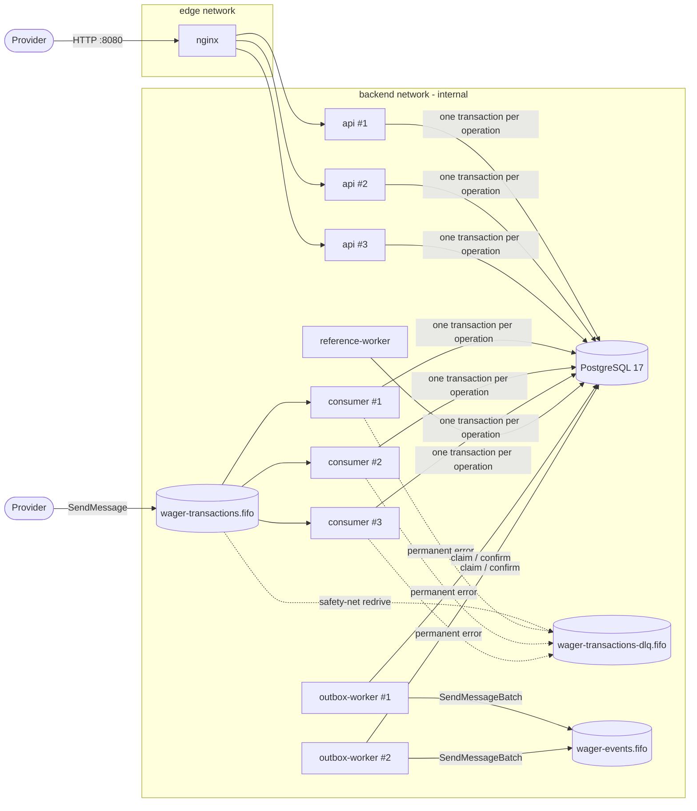
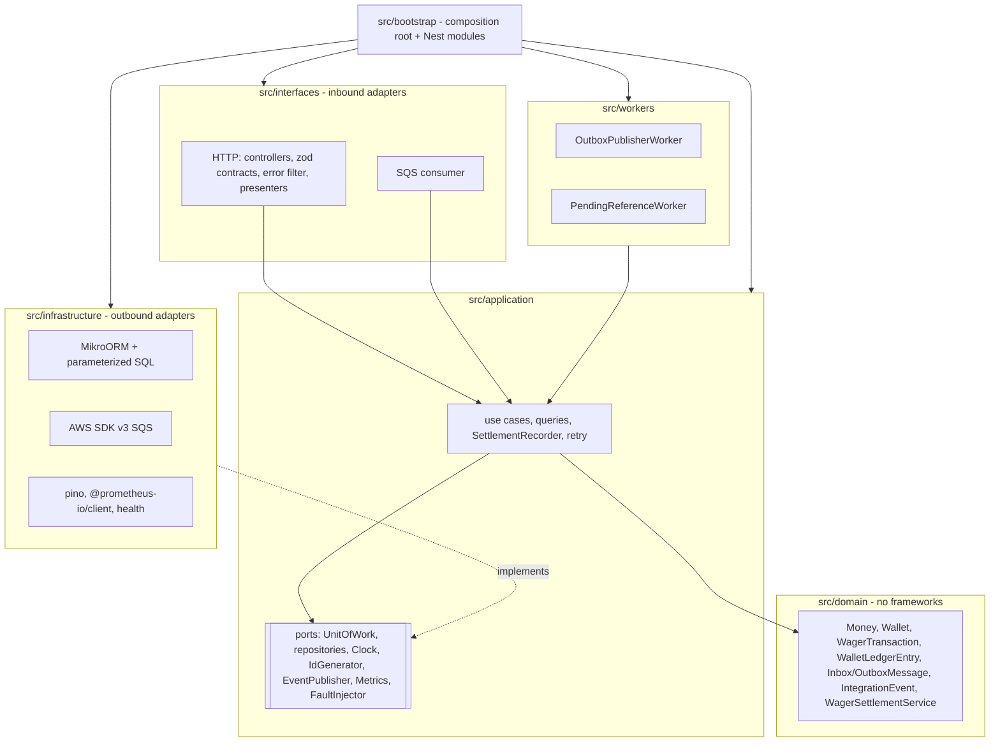

# Architecture — Distributed Wagering Processor

This document justifies the technical decisions behind the solution: what was chosen, what was ruled out, why, and what the consequences and limitations are. Every claim points to the code or the test that proves it.

## Contents

1. [Overview](#1-overview)
2. [Domain model and rules](#2-domain-model-and-rules)
3. [Schema: guarantees enforced by PostgreSQL](#3-schema-guarantees-enforced-by-postgresql)
4. [The financial path: one SQL transaction](#4-the-financial-path-one-sql-transaction)
5. [ADRs](#5-adrs) (ADR-001 to ADR-015)
6. [Sequence diagrams](#6-sequence-diagrams)
7. [Failure matrix](#7-failure-matrix)
8. [Interpretations and assumptions](#8-interpretations-and-assumptions)
9. [Known limitations](#9-known-limitations)
10. [Version choices](#10-version-choices)

---

## 1. Overview

A **modular monolith** deployed as **several independent processes**, all on top of the **same PostgreSQL**. A single Docker image with six entrypoints:



| Process | Entrypoint | Replicas | Responsibility |
|---|---|---|---|
| `api` | `src/entrypoints/api.ts` | 3 | REST, health, metrics. Does not run workers. |
| `consumer` | `src/entrypoints/consumer.ts` | 3 | Consumes `wager-transactions.fifo` with the **same use case** as the API. |
| `outbox-worker` | `src/entrypoints/outbox-worker.ts` | 2 | Publishes committed events to `wager-events.fifo`. |
| `reference-worker` | `src/entrypoints/reference-worker.ts` | 1 (safe with N) | Reprocesses `PENDING_REFERENCE`. |
| `migrations` | `src/entrypoints/migrate.ts` | job | Versioned migrations + provisioning of the runtime login. |
| `queue-bootstrap` | `src/entrypoints/bootstrap-queues.ts` | job | Idempotent creation of the FIFO queues and the DLQ. |

### Layers (hexagonal)



The boundaries are **enforced by lint** (`eslint.config.mjs`, rule `no-restricted-imports`): the domain cannot import NestJS, MikroORM, AWS SDK, pino, @prometheus-io/client or outer layers; the application cannot import adapters.

---

## 2. Domain model and rules

### Aggregates and value objects (`src/domain`)

| Class | Role | Encapsulated guarantees |
|---|---|---|
| `Money` | immutable value object (`Object.freeze`) | `decimal.js`, fixed scale 2, ISO-4217 with 2 decimal places, rejects `NaN`/`Infinity`/scientific notation/sign/leading zeros/>2 decimal places without rounding, overflow beyond `NUMERIC(20,2)`, operations and comparisons only within the same currency. `from` (input contract, non-negative) vs. `fromSigned` (internal differences). |
| `Wallet` | aggregate root | balance only changes through `debit`/`credit`; each change returns **exactly one** `WalletLedgerEntry` with the new version; version starts at 1 and only increments when the balance changes; balance never negative; single currency. |
| `WalletLedgerEntry` | immutable entity | no setters or transitions; `create` proves `balanceAfter = balanceBefore ± amount`; positive amount; same currency. |
| `WagerTransaction` | entity with an explicit state machine | identity and financial content are `readonly`; allowed transitions defined in a table; terminal states have no way out; `OPENING` only through the internal channel; reference required for REFUND/ROLLBACK and forbidden for BET. |
| `InboxMessage` / `OutboxMessage` | messaging records | inbox `PROCESSED` is final; outbox with attempts, backoff and `DEAD` retention. |
| `IntegrationEvent<T>` | abstract envelope | `eventType` and `version` defined in the subclass; `data` with money as a decimal string. Subclasses: `WagerTransactionProcessed`, `WagerTransactionRejected`, `WagerTransactionFailed`, `WagerTransactionPendingReference`, `WalletBalanceChanged`. |
| `WagerSettlementService` | domain service | **all** financial rules, in a single `settle()` method used by HTTP, SQS and the worker. |

All classes use a private constructor + static factories (`create`/`open`/`enqueue`/`receive`) and `rehydrate`, which rebuilds persisted state **without** reapplying transition rules.

### `WagerTransaction` state machine


`PENDING` only exists in memory during the SQL transaction: the decision is made before the commit, so a `PENDING` row is never persisted. Transitions out of terminal states throw `InvalidTransactionStateError` (a programming error). The same is enforced by the `wager_transactions_guard` trigger in the database.

### Financial rules (`WagerSettlementService.settle`)

Evaluation order, under the wallet lock:

1. player ≠ wallet owner → `REJECTED PLAYER_WALLET_MISMATCH`;
2. currency ≠ wallet currency → `REJECTED CURRENCY_MISMATCH`;
3. if there is a reference:
   - missing or not yet terminal → `PENDING_REFERENCE`;
   - reference `REJECTED`/`FAILED` → `REJECTED REFERENCE_NOT_PROCESSED`;
   - different provider/player/wallet/currency/round → `REJECTED REFERENCE_MISMATCH`;
   - kind not allowed (REFUND→BET only; ROLLBACK→BET/WIN/REFUND; WIN/LOSS→BET) → `REJECTED REFERENCE_KIND_NOT_ALLOWED`;
   - reversal with a different amount → `REJECTED REVERSAL_AMOUNT_MISMATCH`;
   - reference already successfully reversed (REFUND **or** ROLLBACK) → `REJECTED REFERENCE_ALREADY_REVERSED`;
4. LOSS → `PROCESSED` with no ledger entry and no version change;
5. direction: BET debits; WIN/REFUND credit; ROLLBACK inverts the reference (credits for a BET; debits for a WIN/REFUND);
6. debit without enough balance → `REJECTED INSUFFICIENT_FUNDS` (BET) or `REVERSAL_INSUFFICIENT_FUNDS` (ROLLBACK);
7. credit that would exceed `NUMERIC(20,2)` → `REJECTED BALANCE_LIMIT_EXCEEDED`;
8. otherwise `PROCESSED` with exactly one entry.

Tests: `test/unit/domain/wager-settlement.test.ts` (rules), `test/integration/wager-processing.test.ts` (with a real database).

### `failureCode` taxonomy (persisted, stable)

| Code | Status | Meaning | The provider should |
|---|---|---|---|
| `INSUFFICIENT_FUNDS` | REJECTED | BET larger than the balance | not resend the same operation |
| `REVERSAL_INSUFFICIENT_FUNDS` | REJECTED | ROLLBACK of a WIN/REFUND would make the balance negative | escalate operationally (a different situation from a bet without funds) |
| `CURRENCY_MISMATCH` | REJECTED | currency ≠ wallet currency | fix the payload (new `externalTransactionId`) |
| `PLAYER_WALLET_MISMATCH` | REJECTED | player does not own the wallet | fix the payload |
| `REFERENCE_NOT_FOUND` | REJECTED | reference did not show up within the attempt limit/TTL | investigate the send order |
| `REFERENCE_MISMATCH` | REJECTED | reference belongs to another player/wallet/currency/round | fix the payload |
| `REFERENCE_KIND_NOT_ALLOWED` | REJECTED | e.g. REFUND of a WIN | fix the payload |
| `REFERENCE_NOT_PROCESSED` | REJECTED | reference ended REJECTED/FAILED | nothing to reverse |
| `REFERENCE_ALREADY_REVERSED` | REJECTED | the reference already has a successful REFUND/ROLLBACK | not resend |
| `REVERSAL_AMOUNT_MISMATCH` | REJECTED | partial reversal (out of scope) | send the full amount |
| `BALANCE_LIMIT_EXCEEDED` | REJECTED | credit would exceed the supported precision | escalate |
| `REFERENCE_RESOLUTION_FAILED` | FAILED | repeated unexpected errors while resolving the reference | escalate (auditable, terminal) |

Errors that **do not** produce a persisted transaction use HTTP error codes (ADR-012).

---

## 3. Schema: guarantees enforced by PostgreSQL

The migrations live in [`migrations/`](migrations/) and are versioned and reversible (`up`/`down`), tested against a real PostgreSQL in `test/integration/migrations.test.ts`. The test `test/integration/schema-guarantees.test.ts` **attacks the schema directly via SQL**, as the owner and as the runtime login, and expects the database to refuse every violation.

### Tables

| Table | Key | Role |
|---|---|---|
| `wallets` | `id` | materialized balance (`NUMERIC(20,2)`), `version` |
| `wager_transactions` | `id` | operations + idempotency + result snapshot + reference scheduling |
| `wallet_ledger_entries` | `id` | append-only ledger, one row per wallet version |
| `inbox_messages` | `(consumer_name, message_id)` | message deduplication |
| `inbox_attempts` | `(consumer_name, message_id)` | real attempts that failed (consumer retry budget) |
| `outbox_messages` | `id` (= eventId), `seq` identity | events to publish |

### Declarative constraints (migration `…0100`, `…0200`)

| Guarantee | Constraint |
|---|---|
| 1 wallet per player+currency | `wallets_player_currency_uq` |
| Balance never negative | `wallets_balance_non_negative_ck`, `ledger_balances_non_negative_ck`, `wager_tx_result_balance_non_negative_ck` |
| Idempotency per provider | `wager_tx_provider_idempotency_key_uq (provider_id, idempotency_key)` |
| Unique external operation per provider | `wager_tx_provider_external_id_uq (provider_id, external_transaction_id)` |
| One ledger row per transaction | `ledger_transaction_uq (transaction_id)` |
| One row per wallet version (and keyset pagination index) | `ledger_wallet_version_uq (wallet_id, wallet_version)` |
| Entry arithmetic | `ledger_arithmetic_ck`: `CREDIT ⇒ after = before + amount`; `DEBIT ⇒ after = before − amount` |
| Entry = amount, currency and wallet of the transaction | composite FK `ledger_transaction_fk (transaction_id, wallet_id, currency, amount) → wager_transactions` |
| Entry currency = wallet currency | composite FK `ledger_wallet_fk (wallet_id, currency) → wallets` |
| Reference only within the same wallet | composite FK `wager_tx_reference_same_wallet_fk (reference_transaction_id, wallet_id)` |
| At most **one successful reversal** per reference | partial unique index `wager_tx_single_successful_reversal_uq (reference_transaction_id) WHERE status='PROCESSED' AND kind IN ('REFUND','ROLLBACK')` |
| Unique message per consumer | `inbox_messages_pk (consumer_name, message_id)` |
| Status consistency | `failure_code` ⇔ REJECTED/FAILED; `processed_at` ⇔ terminal; snapshot required outside PENDING; schedule required in PENDING_REFERENCE; claim only in non-terminal states |
| OPENING internal only | `wager_tx_opening_internal_ck ((kind='OPENING') = (channel='INTERNAL'))` |
| Provider id `internal` reserved to the system (migration `…1023000200`) | `wager_tx_internal_provider_ck ((provider_id='internal') = (channel='INTERNAL'))` |
| Positive amounts (except LOSS) | `wager_tx_amount_positive_ck`, `ledger_amount_positive_ck` |

The FKs are `DEFERRABLE INITIALLY DEFERRED`: they are still checked, but at COMMIT, which frees the order of the INSERTs inside the financial transaction.

### Triggers (migration `…0300`)

Cross-row rules that a `CHECK` cannot express:

| Trigger | When | Guarantees |
|---|---|---|
| `wallet_ledger_entries_append_only` / `_no_truncate` | UPDATE/DELETE/TRUNCATE | immutable ledger, **even for the owner** |
| `wallet_ledger_entries_validate` (constraint trigger, deferred) | INSERT, at COMMIT | chaining (`balance_before` = `balance_after` of the previous version, contiguous versions, first row starts from zero); a matching balance change exists in the wallet; transaction is `PROCESSED`; direction consistent with the kind (LOSS never moves money; ROLLBACK inverts the reference) |
| `wallets_guard` | INSERT/UPDATE | immutable identity; initial version 1; `balance` changes ⇔ `version` +1 exactly |
| `wallets_balance_change_has_ledger_entry` (deferred) | INSERT/UPDATE, at COMMIT | every new `(version, balance)` has the ledger row with that `balance_after` |
| `wager_transactions_processed_has_ledger_entry` (deferred) | INSERT/UPDATE OF status | every `PROCESSED` transaction that moves money has its ledger row |
| `wager_transactions_guard` | UPDATE/DELETE/TRUNCATE | immutable terminal states; immutable identity and financial content; no going back to PENDING; monotonic attempts; transactions never deleted |
| `wager_transactions_validate_reference` | INSERT/UPDATE to PROCESSED | reference exists, is PROCESSED, belongs to the same provider/player/wallet/currency/round, has an allowed kind and (for reversals) the same amount |
| `inbox_messages_guard` / `outbox_messages_guard` | UPDATE | inbox `PROCESSED` and outbox `PUBLISHED` are immutable; event content is immutable |

The errors raise SQLSTATE 23514/23000 with `CONSTRAINT = <name>`, and the application classifies them as `IntegrityViolationError` (500, never retried; see `database-errors.ts`).

**On the balance = ledger sum equality.** A plain `CHECK` cannot compare different tables, and this solution does not claim it does. The equality follows from three complementary mechanisms:

1. **the transactional protocol**: wallet and ledger are written in the same commit, under the wallet lock;
2. **the deferred triggers**: each wallet version has exactly one entry whose `balance_after` is the balance of that version, the chain of entries is continuous from zero, and the arithmetic of each entry is checked. By induction, the current balance equals the sum of the entries **as long as the triggers are enabled**;
3. **reconciliation** (`POST /wallets/:id/reconciliation`): checks the equality independently and detects violations that bypass the triggers. A superuser can disable them with `session_replication_role = replica`, and the `reconciliation.test.ts` test does exactly that to prove detection.

### Privileges (migration `…0400`)

The services connect with a login that is a member of the `wagering_app` group, which has only `SELECT/INSERT` on the ledger, `SELECT/INSERT/UPDATE` on the other tables and **no** `DELETE`/`TRUNCATE`. The migrations run as the owner. The test `the runtime login has no UPDATE/DELETE privilege` checks the refusal with `42501`.

---

## 4. The financial path: one SQL transaction

`ProcessWagerTransactionUseCase` (HTTP and SQS) and `ResolvePendingReferenceUseCase` (worker) use the same `SettlementRecorder` and the same domain service. For a new operation, **a single COMMIT** contains:

1. `SELECT … FROM wallets WHERE id=$1 FOR UPDATE` (wallet row lock);
2. inbox: check by `(consumer_name, message_id)`, when the source is SQS;
3. idempotency: lookup by `(provider_id, idempotency_key)` and by `(provider_id, external_transaction_id)`;
4. lookup of the reference and of existing reversals (under the same lock);
5. domain decision (status, balance, entry);
6. INSERT of the `wager_transactions` row with the **result snapshot** (`result_balance_amount`, `result_wallet_version`);
7. UPDATE of the wallet (balance + version) and INSERT of the entry, if there was a financial effect;
8. INSERT of the events into the outbox;
9. INSERT/UPDATE of the inbox row (SQS);
10. "wake up" `PENDING_REFERENCE` dependents of the same wallet (`next_attempt_at = now`);
11. `COMMIT`, when the deferred triggers and FKs are checked.

No network call to SQS happens inside this transaction. A failure at any step causes a full ROLLBACK, proven by the test `a failure after every write but before COMMIT leaves no partial state` with the fault point `wager.before-commit`.

**Lock order** (fixed on every path): `wallet` row → `wager_transaction` row (worker) → inserted/updated rows. Every operation touches **a single wallet**, because the reference must belong to the same wallet (guaranteed in the domain and by the composite FK). So there is no acquisition of locks on multiple wallets, and no classic deadlock cycle between wallets.

---

## 5. ADRs

### ADR-001 — Modular monolith instead of microservices

**Context.** The core invariants (balance, ledger, idempotency, inbox, outbox) must be committed **atomically**.

**Decision.** A single application codebase with modules separated by layer and by responsibility, deployed as **several processes** (API, consumers, workers) on top of the **same PostgreSQL**. Six entrypoints, with a runtime image shared by the APIs/workers and a separate image for the migration job.

**Alternatives ruled out.** Microservices per entity (wallet, transaction, ledger): they would require distributed transactions (2PC) or sagas with compensation for what is a single COMMIT today. That trades a strong guarantee for eventual consistency exactly where it is not acceptable.

**Consequences.** Trivial, verifiable atomicity; code shared across inputs (HTTP/SQS/worker); horizontal scaling per process type (`--scale`). The limit is the single database (ADR-003). **Future extraction** is possible because the boundaries already exist: the outbox (`wager-events.fifo`) is the natural interface for extracting reads/projections, notifications or reporting without touching the financial core.

### ADR-002 — DDD + Hexagonal

**Decision.** Pure domain (`src/domain`) with aggregates that encapsulate the invariants; application (`src/application`) with use cases and **ports** (`UnitOfWork`, repositories, `Clock`, `IdGenerator`, `EventPublisher`, `WageringMetrics`, `FaultInjector`); adapters in `src/infrastructure` (outbound) and `src/interfaces` (inbound); composition in `src/bootstrap`.

- **`Wallet` aggregate**: the only way to change the balance, and every change returns the entry. Since balance and ledger are created together, one cannot be changed without the other inside the domain.
- **Why the domain does not depend on NestJS.** The financial rules are the most critical asset and the one that most needs testing: the 143 unit tests run in under 2s, with no framework. Frameworks ship major versions (NestJS 12 and MikroORM 7 came out in 2026), and the domain is immune to that. The use cases do not use decorators either: Nest only **exposes** the already-built objects (`CoreModule.register`), and integration tests use the same composition root (`createCore`) without Nest.
- **Allowed dependencies** (enforced by lint): domain → nothing external (only `decimal.js`, which is a pure library); application → domain and ports; adapters → everything.
- **Deliberately avoided**: an interface for every class, pass-through layers, generic mediator/CQRS. Ports exist only where there is more than one real implementation (tests vs. production) or an I/O boundary.

### ADR-003 — PostgreSQL as the source of truth

**Decision.** The materialized balance, the ledger, idempotency, the inbox and the outbox live in PostgreSQL. There is no cache or in-memory state that takes part in any decision.

**Why.** Real ACID: the writes of the financial path are in the same COMMIT (section 4). Isolation is `READ COMMITTED` plus the row lock. After acquiring the lock, each `SELECT` sees previous commits, so the idempotency and balance checks apply to the latest state. Reconciliation uses `REPEATABLE READ READ ONLY` to read wallet and ledger from the **same snapshot**, with no false alarms under concurrent writes (test `concurrent movements never produce a false divergence`). The constraints and triggers in section 3 make the invariants independent of the application.

**Limitations of a single database.** It is a single point of failure (mitigable with a synchronous replica + managed failover). Write throughput is limited to one primary instance, and each wallet is serialized (ADR-005). Partitioning by wallet (sharding) would be the next step, compatible with the model because every operation touches a single wallet.

### ADR-004 — Money and decimal precision

**Decision.** `Money` uses `decimal.js` (a clone with 40 digits of precision, well above `NUMERIC(20,2)`, so additions and subtractions are exact). Input and output are **strings** with fixed scale 2 (`"25.00"`), and persistence uses `NUMERIC(20,2)` with separate currency columns, which the `pg` driver returns as **text**. No `number` touches money in any layer.

- **Why never float.** `0.1 + 0.2 ≠ 0.3` in IEEE-754, and the error accumulates. The tests `0.10 + 0.20 is exactly 0.30` and `large values keep every cent` (18 integer digits) cover this.
- **No implicit rounding.** Inputs with more than two decimal places are **rejected** (`25.001` → 400). Silently rounding would change wagered amounts.
- **Layered validation.** The zod contract (format) and `Money.from` (format + currency + range) validate the input. The database enforces `NUMERIC(20,2)` and the `CHECK`s.
- **Extra defense.** `bun run check:money` uses the TypeScript type checker to fail the build if there is any `parseFloat`, monetary properties typed as `number`, `number` arithmetic on monetary names, `.toFixed` outside `Money`, or `float/real/double/money` columns or monetary columns that are not `NUMERIC(20,2)`. I verified with a probe containing deliberate violations that the check fails as expected.
- **Multi-currency.** The domain accepts ISO-4217 currencies with 2 decimal places (BRL, USD, EUR…). The API accepts those in `ACCEPTED_CURRENCIES` (default `BRL`) for creating wallets. Currency conflicts are tested.

### ADR-005 — Per-wallet concurrency: pessimistic row lock

**Decision.** The unit of concurrency is the `walletId`. Each operation acquires `SELECT … FOR UPDATE` on the wallet row (MikroORM `LockMode.PESSIMISTIC_WRITE`), inside `em.transactional()`, and only then reads, decides and writes. Before that, a *probe* with `FOR UPDATE SKIP LOCKED` (`PESSIMISTIC_PARTIAL_WRITE`) detects, at no extra cost when there is no contention, whether the row was locked. This feeds `wagering_wallet_lock_contention_total`.

**Why not optimistic locking with retry.** On a hot wallet, optimistic means reading, computing, failing on write and trying again, with growing cost and the risk of exhausting retries under contention. Pessimistic turns contention into an ordered queue, with the wait bounded by `lock_timeout`.

**Why not an in-memory mutex.** It does not work across multiple instances and is lost on a crash. The test `across three independent API processes` proves correctness across separate operating-system processes.

**Why not a global lock.** It would serialize all wallets. The test `different wallets never block each other` shows that a locked wallet does not delay another.

**Wait limits.** Each connection is configured with `lock_timeout=5s`, `statement_timeout=15s` and `idle_in_transaction_session_timeout=30s` (`orm.ts`). Short transactions: SQL only, no external I/O.

**Deadlocks and retries.** Deadlock (`40P01`), serialization failure (`40001`), lock timeout (`55P03`) and a unique-constraint race (`23505`) are **transient** errors. The `TransactionRetryExecutor` re-runs the **entire unit of work** (up to 4 attempts, exponential backoff with jitter), starting again from the idempotency check. That way a retry never applies an operation twice. The test `a provoked deadlock is detected by PostgreSQL, retried from scratch and applied exactly once` creates a real cycle and proves the effect is applied once.

> **Lesson learned.** `lock_timeout` must be greater than `deadlock_timeout` (1s). Otherwise, a wait that would form a deadlock ends first as a *lock timeout*. It is still correct (that is also transient and re-run), but the deadlock no longer shows up as such in the metrics.

**Hot wallets: measured trade-off** ([docs/LOAD_TEST.md](docs/LOAD_TEST.md)). With 15% of the traffic on a single wallet, that wallet reaches a p50 of ~535ms, because each commit waits for the previous one. Whoever waits for the lock **holds a pool connection**, which raises the tail latency of the other wallets (p95 616ms vs. 184ms without a hot wallet). Mitigations, not needed for correctness: an in-memory per-wallet queue in each instance (*single-flight*, reduces idle connections without replacing the lock), a dedicated pool, a lower `lock_timeout` to fail early with `503 LOCK_TIMEOUT`, or sub-wallets.

**Timestamps after the lock.** The decision instant is captured **after** the lock. Previously, version N+1 could have a timestamp earlier than version N. The load test revealed this, and every suite now checks that the ledger is non-decreasing in time per version. Against small clock differences between instances, `Wallet` also never dates a movement before the previous one: it uses the later of the instance's "now" and the current `updatedAt`. This preserves `updated_at >= created_at` and the temporal order of the ledger.

### ADR-006 — Persistent idempotency

**Decision.** The `wager_transactions` row itself is the idempotency record, protected by two unique constraints per provider: `(provider_id, idempotency_key)` and `(provider_id, external_transaction_id)`. The original result lives in the same row (`status`, `failure_code`, `result_balance_amount`, `result_wallet_version`, `processed_at`), written in the same commit as the financial effect.

- **Canonical hash.** `payloadHash = SHA-256(hex)` of the canonical JSON (sorted keys, no whitespace, absent optionals omitted, amount normalized by `Money`) of **only** the business fields: `providerId, externalTransactionId, playerId, walletId, roundId, gameId, kind, money{amount,currency}, referenceExternalTransactionId`. The `Idempotency-Key` header, the SQS envelope and any transport metadata are left out. That is why HTTP and SQS produce the same hash (`payload-hash.ts`, with a fixed test vector).
- **Behaviors.**

  | Situation | Result |
  |---|---|
  | same key + same hash | **replay**: returns the original snapshot (`idempotentReplay: true`) |
  | same key + different hash | `409 IDEMPOTENCY_KEY_CONFLICT`, no effect |
  | same `externalTransactionId`, different key | `409 DUPLICATE_EXTERNAL_TRANSACTION`, no effect |
  | HTTP then SQS (or the reverse) for the same operation | the second one is a replay; a single effect |

- **Historical balance.** The replay returns the balance **observed in the original operation**, not the current one. The test `identical replay returns the ORIGINAL result, including the historical balance` does a BET (balance 80), then a WIN and another BET, repeats the BET and checks 80.00.
- **Replay while pending.** If the original operation is `PENDING_REFERENCE`, the replay returns `202` with the current state. Once it is settled by the worker, the replay returns the terminal result, which is immutable from then on.
- **Races.** Concurrent requests for the same operation serialize on the wallet lock. The second one, after the lock, sees the first one's commit and becomes a replay. If two requests with the same key point to **different** wallets (divergent payload), there is no shared lock. In that case the unique constraint decides: the loser gets `23505`, the executor re-runs the unit and it then sees the winning row (→ `409`). The tests `50 parallel calls`, `50 parallel HTTP requests spread over 3 API processes` and `HTTP (3 instances) AND SQS (3 consumer processes) at the same time` prove a single debit.
- **Why not an in-memory cache.** A constraint of the challenge, and incorrect with multiple instances and crashes.

### ADR-007 — Immutable, single-entry ledger

**Decision.** Single-entry ledger: each balance change generates a row with direction, amount, previous balance, resulting balance and wallet version. It is append-only in the domain (no mutation methods), in the repository (only `append`), in the privileges (no UPDATE/DELETE) and in the triggers (not even the owner can change it).

- **Auditing.** The row stores `balance_before`, `balance_after` and `wallet_version`: any historical balance can be reconstructed and verified row by row, without recomputing sums.
- **Reversals by compensation.** REFUND and ROLLBACK generate **new** entries. Nothing is deleted or edited.
- **Double-entry bookkeeping.** It is an optional extra and was not implemented. The design allows adding it ("house"/"provider" counterparty accounts) without changing the protocol.
- **Limitation of cross-table constraints.** See the note in §3: the balance = sum equality comes from protocol + deferred triggers + reconciliation, not from a `CHECK`.

### ADR-008 — Inbox

**Decision.** An `inbox_messages` table keyed by `(consumer_name, message_id)` (the envelope's `messageId`), written **in the same transaction** as the financial effect, with the result (`outcome`: APPLIED, REPLAYED, CONFLICT, WALLET_NOT_FOUND, REJECTED; `transaction_id`; `result_code`) and the payload hash.

- **Real guarantee.** The financial effect and the "message processed" record are atomic: either both exist or neither does. A redelivery finds the inbox row and is answered without reprocessing (`DUPLICATE_MESSAGE` → ack). The same `messageId` with a different payload goes to the DLQ (`MESSAGE_ID_CONFLICT`).
- **Ack after commit.** `DeleteMessage` is only called after the COMMIT. If the process dies between the two, the message comes back after the *visibility timeout* and the inbox absorbs it. The test `consumer killed AFTER the commit and BEFORE the ack` kills the process with SIGKILL at that exact point and checks a single debit and `wagering_inbox_duplicates_total = 1` on the new consumer.
- **DeleteMessage failure.** It is recorded (`wagering_sqs_delete_failures_total`) and handled the same way as the previous case.
- **Scope.** The inbox deduplicates **messages**; business idempotency (ADR-006) deduplicates **operations**. Different messages carrying the same operation become replays, each with its own inbox row.

### ADR-009 — Transactional Outbox

**Decision.** Events are inserted into `outbox_messages` **in the same commit** as the operation. Independent publishers (2 replicas) do:

1. **claim** in a short transaction: `WITH due AS (SELECT … WHERE status='PENDING' AND next_attempt_at <= now AND (claim_expires_at IS NULL OR claim_expires_at < now) ORDER BY seq LIMIT n FOR UPDATE SKIP LOCKED) UPDATE … SET claimed_by, claim_expires_at = now + lease, attempts = attempts + 1`, followed by **COMMIT**;
2. **publish** to SQS **with no open transaction or lock** (`SendMessageBatch`, `MessageDeduplicationId = eventId`, `MessageGroupId = walletId`);
3. **confirm** in another short transaction: `PUBLISHED`, regardless of who holds the lease, because the publish has already happened. On failure, `next_attempt_at` with persisted exponential backoff and jitter, conditional on still owning the lease. After `OUTBOX_MAX_ATTEMPTS` (15) the event becomes `DEAD`: retained for intervention, never discarded (alert `OutboxDeadEvents`).

- **SKIP LOCKED + lease.** Concurrent publishers take disjoint batches (test `two concurrent publishers: … every event published exactly once`, with 60 events). The lease survives the claim's commit. If the publisher dies, the lease expires and another one takes over.
- **At-least-once, not exactly-once.** The test `outbox publisher killed AFTER publishing and BEFORE confirming` kills the process at that point: the event is in SQS and the database still says `PENDING`. After the lease, another publisher republishes with the **same eventId**. Within the SQS FIFO deduplication window (5 min) the copy is discarded; outside it, the consumer deduplicates by `eventId`, demonstrated with the inbox mechanism itself (`downstream-projection`). A committed event is **never** lost.
- **Never before the commit.** A failure before the COMMIT leaves no event at all (test `events are never visible before the financial commit`).
- **Bounded attempts, even when the worker dies.** Every claim counts as an attempt. An event whose publication keeps killing its worker never gets a recorded outcome, so `scheduleRetry` alone would never mark it `DEAD` and it would be republished forever. Before claiming, each publisher therefore retires as `DEAD` the events whose attempts are exhausted and whose last lease expired without an outcome (`retireAbandoned`, same alert `OUTBOX_EVENT_DEAD`). An event requeued by an operator has no lease and gets a new attempt. Test: `a publication that keeps dying before its confirmation is retained as DEAD after max attempts, not republished forever`.
- **Lease vs. publication time.** The lease (30s) can be shorter than the worst case of a slow broker (a 50-event batch is up to 5 `SendMessageBatch` calls, each with SDK retries). Another publisher may then republish part of a batch that is still in flight. The copy carries the same `eventId` as `MessageDeduplicationId`, so SQS FIFO drops it inside its 5-minute window; the only side effect is an extra counted attempt.
- **Ordering.** With concurrent publishers, events for the same wallet in different batches may arrive out of order. Events carry `walletVersion` and `occurredAt` so the consumer can order them or discard old versions. Strict ordering would require "one in-flight event per group", with *head-of-line blocking*, and was not adopted.

### ADR-010 — SQS FIFO

**Decision.** Queues `wager-transactions.fifo` (with `RedrivePolicy` → `wager-transactions-dlq.fifo`, `maxReceiveCount=100` as a safety net) and `wager-events.fifo`, created idempotently by the `queue-bootstrap` job (`DeduplicationScope=messageGroup`, `FifoThroughputLimit=perMessageGroupId`). The recommended `MessageGroupId` is the `walletId`.

- **Per-wallet ordering** reduces contention and preserves the provider's order within the wallet. The consumer processes messages of the same group **sequentially** and different groups **in parallel**. If a message in the group fails, the following ones in the same batch are deferred to keep the order, without spending their attempts (see below).
- **The database is still the guarantee.** SQS FIFO and deduplication are **optimizations**: deduplication only lasts 5 minutes and works per `MessageDeduplicationId`, and it does not protect against redeliveries after the visibility timeout or against producers that generate different ids. The tests deliberately send the same message with different deduplication ids, and the inbox/idempotency keeps a single effect.
- **Error classification in the consumer.**

  | Class | Example | Action |
  |---|---|---|
  | business | REJECTED, conflict, nonexistent wallet | record in the inbox, **ack** |
  | transient | `DATABASE_UNAVAILABLE`, `LOCK_TIMEOUT` | **no ack**; failure counted in `inbox_attempts`; `ChangeMessageVisibility` with exponential backoff + jitter (1s → 60s); after `CONSUMER_MAX_ATTEMPTS` (5) attempts the consumer sends it to the DLQ (`PROCESSING_FAILED`, with `errorCode`) and marks `DEAD_LETTERED` in the inbox |
  | permanent | invalid JSON, violated contract (e.g. `kind: OPENING`), reused `messageId` | **explicit** send to the DLQ (with the reason in the attributes) + `DEAD_LETTERED` inbox row, if possible |
  | unexpected | bug | same as transient: retry up to `CONSUMER_MAX_ATTEMPTS`, then DLQ (`PROCESSING_FAILED`) |

- **The attempt budget is per message and persistent, not `ApproximateReceiveCount`.** In a FIFO group, the messages behind a failing head come back with it on every retry and are deferred without being processed: their receive count goes up without any attempt. With the SQS redrive as the limit, those messages would go to the DLQ without ever being processed. That is why each real failure is counted in `inbox_attempts`, in its own short transaction (the one that failed was rolled back), and the consumer decides on the DLQ based on that counter. The SQS redrive (`SQS_MAX_RECEIVE_COUNT=100`, validated as `>= CONSUMER_MAX_ATTEMPTS × SQS_MAX_MESSAGES`) remains only as a safety net for failures the consumer cannot count, such as a message that crashes the process. When a message goes to the DLQ, the counter is reset: a manual redrive starts over with the full budget. Test: `messages behind a failing FIFO group head keep their own budget`.

- **A database outage does not exhaust attempts.** On the first `DATABASE_UNAVAILABLE` the consumer **pauses consumption** (metric `wagering_sqs_consumer_paused = 1`) and probes PostgreSQL (`SELECT 1`) with backoff up to 5s. It only fetches messages again once the database responds. Without this, with 5 attempts and a 1s to 60s backoff, an outage of ~30s would send the head message of every group to the DLQ, and the unblocked FIFO group would let the following messages (a REFUND, for example) through out of order. Test: `a database outage longer than the retry budget pauses consumption instead of dead-lettering`. During the pause, `DATABASE_UNAVAILABLE` does not spend attempts. **Per-wallet** transient errors (such as `LOCK_TIMEOUT`) do not pause the consumer and consume the normal budget.
- **Visibility.** The *visibility timeout* is configurable (30s). A heartbeat extends the visibility every half timeout while the message is being processed.
- **Graceful shutdown.** On SIGTERM the consumer stops fetching, finishes the in-flight messages and immediately returns (`VisibilityTimeout=0`) the ones received but not started. **The ongoing long poll is not aborted**: aborting a `ReceiveMessage` that SQS has already answered makes the messages invisible and consumes one of their attempts without anyone processing them. The integration tests caught exactly this defect in an earlier version (messages going to the DLQ prematurely), and the fix reduced the consumer test time from ~6s to ~1s. The long poll ends within `WaitTimeSeconds` (20s), inside the 30s `stop_grace_period`.

### ADR-011 — Out-of-order references

**Decision.** REFUND/ROLLBACK (and WIN/LOSS with a reference) whose reference does not exist, or is not yet terminal, are **persisted** as `PENDING_REFERENCE`, emit `WagerTransactionPendingReference`, **do not move** the wallet and get `next_attempt_at` and `reference_expires_at`. The `PendingReferenceWorker`:

1. claims the due ones with `FOR UPDATE SKIP LOCKED` + lease (short transaction);
2. for each one, in a transaction: locks the **wallet**, then the **transaction** (same order as the main path), checks that it is still `PENDING_REFERENCE` and still due, and calls the **same** `SettlementRecorder`/`WagerSettlementService` as the normal flow.

- **Backoff and limits.** `2s × 2^attempts`, capped at 5 min, until the **1h TTL** expires; **20 attempts** is only a safety cap (with the defaults they would last ~68 min, so the TTL is the limit that applies). Why these values: the TTL is the business window in which a provider is expected to deliver the referenced operation (it normally follows within seconds; one hour absorbs provider retries and outages on their side), after which a person should investigate. The backoff cap of 5 min bounds how late a reference that arrives without waking its dependents is noticed, and keeps the worker's load per stuck transaction at ≤ 12 queries per hour. A reference that does arrive wakes its dependents immediately (`wakeDependents`), so the backoff never delays the normal out-of-order case. When exhausted: `REJECTED REFERENCE_NOT_FOUND` + `WagerTransactionRejected`. Repeated unexpected errors end up as `FAILED REFERENCE_RESOLUTION_FAILED` (auditable, terminal). Everything is configurable (`REFERENCE_*`) and tested with an injectable `Clock` (`ManualClock`), with no real waiting.
- **Immediate reaction.** When the reference is settled, the dependents in the same wallet have their `next_attempt_at` moved up to "now" in the same transaction. The worker resolves them on the next cycle (~1s), without waiting for the backoff. Chains (ROLLBACK → REFUND → BET) resolve in cascade.
- **Concurrency.** Multiple instances are safe: the claim hands out disjoint batches and settlement rechecks the status under the lock. The test `competing worker instances …` runs each claim **twice in parallel** from different instances and checks exactly 8 effective attempts and 8 discarded ones. With 8 REFUNDs for the same BET, only 1 is applied and the other 7 get `REFERENCE_ALREADY_REVERSED`.
- **REFUND vs. ROLLBACK ambiguity.** See §8: at most one successful reversal per transaction, also guaranteed by the partial unique index.

### ADR-012 — HTTP and errors

**Decision.** A single error format `{ code, message, correlationId, retryable, details? }`, where `code` and `retryable` are the machine contract and `message` is only for humans. Consistent mapping across all endpoints (`http-errors.ts`):

| Status | When | `retryable` |
|---|---|---|
| `201` | transaction PROCESSED the first time; wallet created | — |
| `200` | replay of PROCESSED; queries; reconciliation | — |
| `202` | `PENDING_REFERENCE` (first time or replay); `Location` to poll | — |
| `400` | invalid payload/parameter (`VALIDATION_ERROR`, `INVALID_MONEY`, `UNSUPPORTED_CURRENCY`…), malformed JSON, missing `Idempotency-Key` | false |
| `403` | provider not authorized (`PROVIDER_FORBIDDEN`, auth extension point) | false |
| `404` | nonexistent resource (`WALLET_NOT_FOUND`, `TRANSACTION_NOT_FOUND`, `ROUTE_NOT_FOUND`) | false |
| `409` | `WALLET_ALREADY_EXISTS`, `IDEMPOTENCY_KEY_CONFLICT`, `DUPLICATE_EXTERNAL_TRANSACTION` (`details.existingTransactionId`) | false |
| `422` | business rule rejection: `code = failureCode`, plus `transactionId`, `status`, `balance` and `idempotentReplay` | false |
| `500` | `FAILED` (terminal) or unexpected error/integrity violation (no internal details) | false |
| `503` | `DATABASE_UNAVAILABLE`, `LOCK_TIMEOUT`, `CONCURRENCY_CONFLICT`, `STATEMENT_TIMEOUT`; header `Retry-After: 1` | **true** |

Retrying is **always safe** thanks to idempotency. `retryable: true` indicates that a retry should yield a different result. A nonexistent wallet in a transaction produces `404` with no persistence, because the FK requires the wallet. Via SQS the result is recorded in the inbox. The test `PostgreSQL unavailable: 503 retryable + not ready (live stays up), then automatic recovery` actually blocks connections to the database.

### ADR-013 — Observability and recovery

- **JSON logs** (pino) with `service`, `instanceId` and context propagated via `AsyncLocalStorage`: `correlationId` (the `X-Correlation-Id` header or generated, returned in the response and in the events), `requestId`, `messageId`, `transactionId`, `walletId`, `providerId`. Request/message bodies are never logged, and sensitive keys are redacted. Alert lines carry `alert` (`RECONCILIATION_DIVERGENCE`, `MESSAGE_DEAD_LETTERED`, `OUTBOX_EVENT_DEAD`).
- **Database errors never leak row values.** Driver messages quote the SQL bindings and PostgreSQL's `detail` ("Failing row contains (…)"): player ids, amounts, idempotency keys. The unit of work translates every database error into an application error whose message names only the SQLSTATE and the constraint (`IntegrityViolationError`, `UnexpectedDatabaseError`); the original stays in `cause`, which is never logged. knex also runs with `compileSqlOnError: false`. Test: `database errors never carry SQL bindings or row values into what gets logged`.
- **Prometheus metrics** (per instance, `/metrics`; blocked at nginx): transactions by kind/status/channel, replays, conflicts, inbox duplicates, retries by reason, lock wait and contention, lock timeouts, deadlocks, use case and HTTP latency, messages received/acked/retried/DLQ'd, `DeleteMessage` failures, DLQ depth, outbox pending count and **lag**, `DEAD` events, commit→publish delay, pending reference backlog and **lag**, reconciliations and divergences.
- **Health.** `/health/live` only indicates that the process responds. `/health/ready` checks PostgreSQL (`SELECT 1`) and SQS (`GetQueueAttributes`) with a 2s timeout. If the database goes down, the instance becomes *not ready* (503) but stays alive, with no restart loop, and recovers on its own.
- **Reconciliation** on demand, read-only, `REPEATABLE READ`: compares balance vs. Σ ledger, version vs. last row, and chain continuity. Divergences are logged, counted and alerted, **never corrected automatically**.
- **`observability` profile.** Prometheus discovers each replica via Docker DNS (verified: 9 targets `up`). Grafana ships with a provisioned dashboard and alert rules (`infra/monitoring/prometheus/alerts.yml`).
- **Diagnostics.** `correlationId` ties together the HTTP request, the logs of all instances and the published events. The inbox records the result of each message, and the outbox records the attempts and the last error.
- **OpenTelemetry/Jaeger.** Not included: OTel auto-instrumentation relies on Node module hooks that are not reliable on Bun. The `correlationId` covers the tracing needs of this scope.

### ADR-014 — Docker and infrastructure

- **Multi-stage images** (`infra/docker/Dockerfile`): `deps` (frozen lockfile and local patches) → `dev` (test toolbox) → `build` (`tsc`) → `prod-deps` → `runtime` (`oven/bun:1.4.3-slim`, **non-root** user `bun`, only `dist/` + production dependencies). The `migration-runtime` target adds the migration tooling and is used only by the owner job. The ORM loads the migrator and the migration list dynamically when `withMigrator=true`; APIs and workers do not load those dependencies.
- **Separate API and workers.** Each process runs a single role (no workers hidden inside the API), which allows scaling and sizing connection pools independently (api 10, consumer 5, outbox 3, reference 3; `max_connections=200`).
- **Ordered startup.** `postgres` and `localstack` healthy → `migrations` and `queue-bootstrap` jobs (`service_completed_successfully`) → `api`/workers (healthy via `/health/ready`) → `nginx`. `init: true` (correct signal handling), `stop_grace_period: 30s`, `restart: unless-stopped`.
- **Networks.** `edge` (nginx + api) and `backend` (`internal: true`: database, broker, workers with no external route). Only nginx publishes a port (`8080`, or `API_PUBLIC_PORT`).
- **nginx.** `server api:3000 resolve` with `resolver 127.0.0.11`: replicas are rediscovered every 5s, with round-robin (verified: 3 distinct `X-Instance-Id`). `proxy_next_upstream` does not resend POST. `X-Upstream-Addr` header.
- **Reproducibility.** Exact versions in `package.json`, `bun.lock` with `--frozen-lockfile`, images with pinned tags, UTC timezone in every container and on every PostgreSQL connection. Tests run without Bun on the host (`docker compose --profile tools run --rm toolbox …`).

### ADR-015 — Authentication

**Scope decision.** Authentication is not scored and was left as an **explicit extension point**, with no home-grown implementation.

- **Extension point.** The `ProviderIdentityResolver` port and the `ProviderAuthGuard` (`src/interfaces/http/auth/provider-identity.ts`) are already applied to the controllers, and `ApiModule.register(core, resolver)` takes the adapter to use. Every write endpoint and every per-provider query endpoint calls `assertCanActFor(request, providerId)` (`403 PROVIDER_FORBIDDEN`). `GET /wagering/transactions/:id` answers `404` for a transaction of a provider the caller cannot act for, so ids cannot be probed. The local adapter `NoopProviderIdentityResolver` accepts everything and **is not security**: the process logs a warning (`AUTH_MODE=none`) at startup. Test: `a caller scoped to another provider gets 403 on its routes and 404 on a foreign transaction id`.
- **OIDC integration design (Keycloak/Zitadel).**
  1. Each provider is a confidential *client* in the IdP (*client credentials* flow), with a `provider_id` claim (a mapper in Keycloak).
  2. An `OidcProviderIdentityResolver` validates the Bearer JWT: signature via JWKS (with caching and rotation), `iss`, `aud`, `exp`/`nbf` and allowed algorithms. It maps `provider_id` → `ProviderIdentity.providers`.
  3. The guard compares the payload's `providerId` with the identity's (`403 PROVIDER_FORBIDDEN`).
  4. Health and `/metrics` remain public internally; nginx already blocks `/metrics` at the edge.
  5. SQS messages are a trusted internal channel (per the challenge). The provider identity in the message is still subject to the domain validations (e.g. `PLAYER_WALLET_MISMATCH`, reference from the same provider).
  6. In Compose, Keycloak would go into its own profile, with the realm imported at startup.

### ADR-016 — MikroORM as the ORM

**Decision.** MikroORM 6 (the challenge's preferred option; Prisma is forbidden), used as a Unit of Work around hand-written SQL where it matters.

- **Unit of Work and identity map.** One `em.transactional` per use case gives exactly the model the financial path needs: every change tracked in the scope (wallet, transaction, ledger, inbox, outbox) is flushed and committed together or rolled back together, with the isolation level chosen per call (`READ COMMITTED` for writes, `REPEATABLE READ` read-only for reconciliation).
- **No ORM in the domain.** Records are declared with `EntitySchema` in `infrastructure/persistence/mikroorm/records.ts`, so domain classes carry no decorators. Mappers convert records to aggregates with `rehydrate` and back.
- **Money mapping.** `NUMERIC(20,2)` columns are declared as `decimal` and exposed as **strings** (the `pg` driver returns `NUMERIC` as text), and the mappers turn them into `Money`. No `number` ever holds an amount (`check:money`).
- **Hand-written SQL where the ORM would hide the guarantee.** Row locks (`SELECT … FOR UPDATE`), claims with `FOR UPDATE SKIP LOCKED` and leases, and the ledger balance (`Σ` in `NUMERIC`) use parameterized knex queries inside the same transaction (`sql()` helper).
- **Schema owned by migrations.** Constraints, partial indexes, triggers and grants are written by hand in versioned, reversible migrations (an explicit list in `migrations/index.ts`), never generated from the entities.
- **Alternatives.** TypeORM (accepted by the challenge) relies on decorators in the entities and has a weaker unit of work, which would push transaction handling into every repository. Drizzle/Kysely are outside the allowed options.

---

## 6. Sequence diagrams

### 6.1 BET processing (HTTP)

```mermaid
sequenceDiagram
    autonumber
    participant P as Provider
    participant N as nginx
    participant A as api (1 of 3)
    participant DB as PostgreSQL
    participant O as outbox-worker
    participant Q as wager-events.fifo
    P->>N: POST /wagering/transactions (Idempotency-Key)
    N->>A: round-robin
    A->>A: validates contract (zod) and Money; computes payloadHash
    A->>DB: BEGIN
    A->>DB: SELECT wallet FOR UPDATE
    A->>DB: lookup by (provider, key) and (provider, externalId)
    A->>A: WagerSettlementService.settle → DEBIT, PROCESSED
    A->>DB: INSERT transaction (+snapshot), UPDATE wallet, INSERT ledger, INSERT outbox ×2
    A->>DB: COMMIT (deferred triggers check ledger ↔ wallet)
    A-->>P: 201 {status: PROCESSED, balance, idempotentReplay:false}
    O->>DB: claim (SKIP LOCKED + lease) and COMMIT
    O->>Q: SendMessageBatch (dedup = eventId, group = walletId)
    O->>DB: marks PUBLISHED
```

### 6.2 Concurrent duplicate requests

```mermaid
sequenceDiagram
    autonumber
    participant R1 as request 1 (api #1)
    participant R2 as request 2 (api #2)
    participant DB as PostgreSQL
    par
        R1->>DB: BEGIN; SELECT wallet FOR UPDATE (acquires)
    and
        R2->>DB: BEGIN; SELECT wallet FOR UPDATE (waits)
    end
    R1->>DB: idempotency key missing → INSERT transaction, UPDATE wallet, INSERT ledger, outbox
    R1->>DB: COMMIT
    DB-->>R2: lock granted
    R2->>DB: SELECT by (provider, key) → finds R1's commit
    R2->>R2: same hash → REPLAY (no write)
    R2->>DB: COMMIT
    Note over R1,R2: 201 for R1, 200 + idempotentReplay for R2, a single debit.<br/>Different wallets with the same key: unique constraint → retry → 409.
```

### 6.3 REFUND before the BET

```mermaid
sequenceDiagram
    autonumber
    participant P as Provider
    participant A as api
    participant DB as PostgreSQL
    participant W as reference-worker
    P->>A: REFUND (ref = bet-1)
    A->>DB: lock wallet; bet-1 does not exist
    A->>DB: INSERT REFUND PENDING_REFERENCE (next_attempt_at = +2s) + PendingReference event; COMMIT
    A-->>P: 202 Accepted (Location)
    P->>A: BET bet-1
    A->>DB: lock wallet; DEBIT; INSERT BET PROCESSED
    A->>DB: UPDATE wallet dependents: next_attempt_at = now; COMMIT
    A-->>P: 201
    W->>DB: claim due ones (SKIP LOCKED + lease); COMMIT
    W->>DB: lock wallet → lock REFUND; still PENDING_REFERENCE?
    W->>W: same rules: kind, amounts, round, not yet reversed
    W->>DB: CREDIT, REFUND PROCESSED, events; COMMIT
    Note over W,DB: If bet-1 never arrives: backoff 2s, 4s, 8s… capped at 5 min, until the 1h TTL,<br/>then REJECTED REFERENCE_NOT_FOUND + event.
```

### 6.4 Outbox after the commit

```mermaid
sequenceDiagram
    autonumber
    participant O1 as outbox-worker #1
    participant O2 as outbox-worker #2
    participant DB as PostgreSQL
    participant Q as wager-events.fifo
    O1->>DB: claim batch A (FOR UPDATE SKIP LOCKED, lease 30s, attempts+1); COMMIT
    O2->>DB: claim batch B (rows of A skipped); COMMIT
    O1->>Q: publishes A (no open lock)
    O1--xO1: process dies before confirming
    O2->>Q: publishes B
    O2->>DB: B → PUBLISHED
    Note over DB: lease on A expires
    O2->>DB: claim A (attempts = 2); COMMIT
    O2->>Q: republishes A with the same eventIds
    O2->>DB: A → PUBLISHED
    Note over Q: Copy discarded by FIFO dedup (5 min) or deduplicated<br/>by the consumer via eventId: at-least-once, no loss.
```

### 6.5 Failure between commit and ack (SQS)

```mermaid
sequenceDiagram
    autonumber
    participant Q as wager-transactions.fifo
    participant C1 as consumer #1
    participant C2 as consumer #2
    participant DB as PostgreSQL
    Q->>C1: ReceiveMessage (visibility 30s)
    C1->>DB: BEGIN; lock wallet; inbox (consumer, messageId) missing
    C1->>DB: financial effect + INSERT inbox PROCESSED; COMMIT
    C1--xC1: SIGKILL before DeleteMessage
    Note over Q: visibility timeout expires
    Q->>C2: redelivery (ApproximateReceiveCount = 2)
    C2->>DB: BEGIN; lock wallet; inbox already PROCESSED, same hash
    C2->>DB: COMMIT (no writes)
    C2->>Q: DeleteMessage (ack)
    Note over C2: wagering_inbox_duplicates_total += 1, a single effect.
```

---

## 7. Failure matrix

| Interruption / failure point | Database state | Broker state | Recovery | Test |
|---|---|---|---|---|
| API process dies **before COMMIT** | nothing (PostgreSQL rolls back when the connection is lost) | — | client retries with the same key → applied once | `API killed after writing and BEFORE COMMIT` (real SIGKILL) |
| API dies **after COMMIT, before the response** | operation committed | — | client retries → `200` replay with the original result | `identical replay returns the ORIGINAL result` |
| Error at any step before COMMIT | nothing | nothing | exception; idempotency allows retrying | `a failure after every write but before COMMIT leaves no partial state` |
| PostgreSQL unavailable | — | messages stay in the queue: the consumer pauses and only resumes when the database responds | HTTP: `503 DATABASE_UNAVAILABLE` (retryable), readiness 503, liveness 200; recovers on its own | `PostgreSQL unavailable: 503 …`, `a database outage longer than the retry budget pauses consumption …` |
| Wallet lock held beyond `lock_timeout` | nothing | — | internal retry; then `503 LOCK_TIMEOUT` (retryable) | `lock_timeout: bounded wait …` |
| Deadlock | victim transaction rolled back | — | automatic re-run of the entire unit | `a provoked deadlock is detected …` |
| Consumer dies **before COMMIT** | nothing | message invisible until the timeout | redelivery → processed once | `restart under load` (SIGKILL mid-flow) |
| Consumer dies **after COMMIT, before the ack** | effect + inbox committed | message comes back after the timeout | inbox → `DUPLICATE_MESSAGE` → ack | `consumer killed AFTER the commit and BEFORE the ack` |
| `DeleteMessage` fails | committed | message comes back | same as the previous row; failure metric | — (same path as the previous row) |
| Persistent transient error | `inbox_attempts`; inbox `DEAD_LETTERED` | retries with backoff; after 5 real attempts → DLQ by the consumer | operator fixes the cause and redrives; inbox guarantees a single effect | `transient failures are retried …`, `… dead-lettered after maxAttempts real attempts`, `… keep their own budget` |
| Invalid message / violated contract | inbox `DEAD_LETTERED` (if there is a `messageId`) | immediate DLQ, with reason | fix at the source | `invalid messages go straight to the DLQ …` |
| SIGTERM on the consumer | in-flight work completed | unstarted ones returned (visibility 0) | another instance processes them | `graceful stop: in-flight work completes`, `restart under load` (SIGTERM) |
| Outbox: dies **after the claim, before publishing** | `PENDING` with lease | nothing published | lease expires → another publisher takes over | same lease mechanism exercised in `crash after SQS publish and before the DB confirmation: lease expires …` |
| Outbox: dies **after publishing, before confirming** | `PENDING` with lease, `attempts=1` | event published | lease expires → republishes with the same `eventId` (`attempts=2`) | `outbox publisher killed AFTER publishing and BEFORE confirming` (real SIGKILL) |
| Events SQS unavailable | `PENDING`, persisted backoff | — | retries up to 15; then `DEAD` (retained, alert) and manual re-enqueue | `broker failure: backoff persisted …` |
| Reference worker dies midway | transaction rolled back; lease active | — | lease expires → another attempt | `an expired lease makes the transaction claimable …` |
| Reference never arrives | `PENDING_REFERENCE` until exhausted | `PendingReference` event | `REJECTED REFERENCE_NOT_FOUND` + event | `backoff, then REJECTED with REFERENCE_NOT_FOUND …` |
| Restart of all services | everything that was committed | unacknowledged messages reappear | inbox + idempotency | `restart under load …` (final consistency verified) |
| LocalStack restart | — | **queues and messages lost** (no persistence in the community edition) | rerun `queue-bootstrap`; see Limitations | — |

---

## 8. Interpretations and assumptions

1. **REFUND vs. ROLLBACK on the same BET (conservative interpretation).** The README forbids reversing twice "with the same kind". This solution goes further and allows **at most one successful reversal per referenced transaction, whatever the kind**. A REFUND followed by a ROLLBACK of the same BET (or the reverse) would credit the same economic value twice. The second reversal is `REJECTED REFERENCE_ALREADY_REVERSED`, enforced in the domain and by the partial unique index. A **ROLLBACK of a REFUND** is allowed as a separate compensating operation: the reference is the REFUND, not the BET. Consequence: after a ROLLBACK-of-REFUND, the original BET cannot be refunded again (that would require an operational procedure).
2. **WIN and LOSS** may reference a BET from the same round (optional). If the reference has not arrived yet, they wait like reversals do. A BET may have several WINs (e.g. bonus rounds). A WIN referencing a BET that has **already been reversed** (REFUND/ROLLBACK) is accepted: the challenge does not forbid this case, and paying out a prize is a fact independent of returning the bet. If the business requires otherwise, the rule is one more line in `validateReference`.
3. **LOSS** accepts `0.00` (or any amount ≥ 0): it records the outcome, never moves money, produces no ledger entry and no version change, and emits `WagerTransactionProcessed`. A **WIN of 0.00** is rejected as an invalid payload (400); use LOSS.
4. **Nonexistent wallet** in `POST /wagering/transactions` → `404 WALLET_NOT_FOUND`, with no persistence (the FK requires the wallet). Via SQS the result goes to the inbox and the message is acked.
5. **Player or currency incompatible with the wallet** are **persisted** business rejections (auditable), not validation errors.
6. **Idempotency per provider**: keys are unique per `providerId`.
7. **Replay HTTP codes**: PROCESSED → `201` the first time and `200` on replay; REJECTED → always `422`; PENDING → `202` while pending; FAILED (reference resolution failed after repeated unexpected errors) → `500 REFERENCE_RESOLUTION_FAILED`, terminal and auditable.
8. **Wallet version** starts at 1 already holding the opening balance (OPENING is version 1); with a zero initial balance there is no entry, and the first movement is version 2.
9. **OPENING** uses provider `internal`, `externalTransactionId = wallet-opening:<walletId>` and channel `INTERNAL` (`OPENING` only exists on that channel, and vice versa). The provider id `internal` is **reserved**: providers cannot submit under it (contract `400` on HTTP, DLQ `INVALID_MESSAGE` on SQS, domain rule, and the `wager_tx_internal_provider_ck` constraint). Otherwise a request with `providerId: "internal"` would look up the idempotency keys of the system's own transactions.
10. **Time**: the application uses a `Clock` (injectable in tests), not the database's `now()`. It assumes clocks synchronized (NTP) across instances, as in any ordinary cluster.
11. **Currencies**: multi-currency domain (ISO-4217 with 2 decimal places); the API only creates wallets in the currencies listed in `ACCEPTED_CURRENCIES` (default `BRL`). Transactions in another valid currency against a BRL wallet are `CURRENCY_MISMATCH` (persisted).
12. **Identifiers** (`providerId`, `externalTransactionId`, `roundId`, `gameId`, `playerId`) accept letters, digits and `._:-` (up to 64/128 characters). `walletId` is a UUID, accepted in upper or lower case and normalized to lower case in the contract (HTTP and SQS) before hashing: both spellings are the same wallet and the same operation. `Idempotency-Key`: 1 to 255 printable ASCII characters.
13. **Correlation id on SQS**: uses the envelope's `correlationId`; otherwise the message attribute; otherwise the `messageId`. Only a candidate that fits the schema (≤ 128 safe characters) is used; if none fits, a UUID is generated. A long `messageId` (the contract allows 256) never prevents the operation from being recorded.
14. **Inbox row for a never-processed message** (`DEAD_LETTERED`): when resent (redrive or fix at the source), the message is processed normally, and the payload actually processed becomes the one that subsequent redeliveries must match.
15. **`REFERENCE_NOT_FOUND` also covers a reference that exists but never settles** within the TTL (for example a ROLLBACK waiting on a REFUND that is itself waiting for its BET). For the provider the action is the same: the referenced operation did not become usable in time.

---

## 9. Known limitations

- **LocalStack community has no persistence**: restarting the container loses queues and unconsumed messages (the `queue-bootstrap` job recreates the queues on the next `up`). In production, real SQS is durable.
- **Event ordering** per wallet is not guaranteed across batches from concurrent publishers (ADR-009); consumers must use `walletVersion`/`eventId`.
- **The deduplication window** of SQS FIFO is 5 minutes; after it, event duplicates reach the consumers (who must deduplicate by `eventId`).
- **Hot wallets** have throughput limited by serialization and hold connections while waiting (measured in `docs/LOAD_TEST.md`).
- **No retention/archiving** of `inbox_messages`, `inbox_attempts` and published `outbox_messages` (they grow indefinitely; this would be a scheduled job).
- **On-demand reconciliation**, per wallet; there is no scheduled sweep.
- **Authentication**: only the extension point (ADR-015).
- **No OpenTelemetry/Jaeger** (ADR-013).
- **Single-entry ledger**; no double-entry bookkeeping.
- **Partial reversals** and **a new refund after a ROLLBACK of a REFUND** are not supported (§8).
- **Triggers can be disabled by a superuser** (`session_replication_role`); reconciliation detects the effect but does not prevent it.
- **Correlation of deferred settlements.** When the reference worker settles a `PENDING_REFERENCE` transaction, its log lines and events use `correlationId = reference-resolution:<transactionId>` instead of the original request's id (the transaction row does not store it). The `transactionId` still ties the two together.
- **A pending-reference row that crashes the worker** is retried after each lease expiry with no attempt counted (the attempt is only recorded with an outcome). Nothing is applied twice (each attempt is one rolled-back transaction), but the row is not retired automatically; the TTL does not help because it is only evaluated by a successful attempt.
- **Development on the host** (`bun run dev` outside Docker) requires Bun installed and the Postgres/LocalStack ports exposed (`docker-compose.dev.yml`). In this validation environment Bun was not installed on the host, so this mode was not exercised here; all commands were validated inside containers.

---

## 10. Version choices

| Component | Version | Reason |
|---|---|---|
| Bun | 1.4.3 | stable 1.x (12 days since release at the time of the choice, versus 1.4.4 released that same day) |
| TypeScript | 6.0.3 | latest version supported by `typescript-eslint` 8.x (native TS 7 is not supported yet) |
| NestJS | 11.2.7 | mature line (since Jan 2025) and still receiving patches; 12.x was 8 weeks old and moved to ESM-only |
| MikroORM | 6.6.17 | mature line with patches (Oct 2026); 7.x removed knex and changed APIs |
| PostgreSQL | 17 (alpine) | stable; no 18 feature is needed |
| LocalStack | 4.14.0 | **latest community image that runs without `LOCALSTACK_AUTH_TOKEN`**; the `2026.x` tags exit with "License activation failed" (verified). Configurable via `LOCALSTACK_IMAGE`/`LOCALSTACK_AUTH_TOKEN` |
| nginx | 1.28 | supports `server … resolve` in open source (replica rediscovery) |
| zod 4.6, decimal.js 10.6, pino 10.4, @prometheus-io/client 0.16, AWS SDK v3 3.1150 | — | stable versions pinned exactly; `bun.lock` with `--frozen-lockfile` |
| `ajv` 8.13 (devDependency) | — | fixes hoisting: ESLint pulls `ajv@6` into the root and `ajv-draft-04` (from `umzug`, used by the Migrator) needs 8. Only affects the development environment: the production image does not include ESLint |
