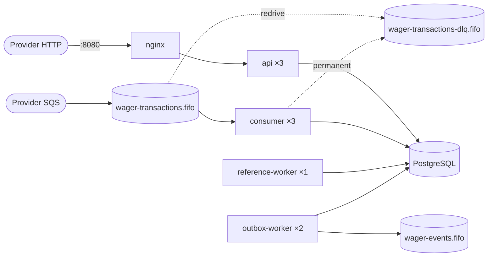

# Jungle Wagering Processor

[](https://github.com/DanielnetoDotCom/jungle-wagering-processor/actions/workflows/ci.yml)
[](https://github.com/DanielnetoDotCom/jungle-wagering-processor/actions/workflows/codeql.yml)

Distributed financial service that processes wagering transactions (BET, WIN, LOSS, REFUND, ROLLBACK) received from game providers over **HTTP** and **SQS**. The focus is financial correctness under concurrency, duplication, out-of-order delivery and failures. Solution to the [Jungle Gaming technical challenge](https://github.com/junglegaming/backend-challenge).

> **Decisions and rationale:** [ARCHITECTURE.md](ARCHITECTURE.md) · **Tests:** [docs/TEST_REPORT.md](docs/TEST_REPORT.md) · **Load:** [docs/LOAD_TEST.md](docs/LOAD_TEST.md) · **CI/CD:** [docs/CI_CD.md](docs/CI_CD.md)

## Contents

1. [The problem](#1-the-problem)
2. [Technologies](#2-technologies)
3. [Architecture](#3-architecture)
4. [Environment requirements](#4-environment-requirements)
5. [Start with Docker Compose](#5-start-with-docker-compose)
6. [Verify the three APIs](#6-verify-the-three-apis)
7. [Run the tests](#7-run-the-tests)
8. [Migrations](#8-migrations)
9. [Endpoints (cURL)](#9-endpoints-curl)
10. [Send messages via SQS](#10-send-messages-via-sqs)
11. [Inspect Inbox, Outbox and DLQ](#11-inspect-inbox-outbox-and-dlq)
12. [Test idempotency](#12-test-idempotency)
13. [Reproduce the concurrency scenarios](#13-reproduce-the-concurrency-scenarios)
14. [Reconciliation](#14-reconciliation)
15. [Observability](#15-observability)
16. [Clean up the environment](#16-clean-up-the-environment)
17. [Environment variables](#17-environment-variables)
18. [Troubleshooting](#18-troubleshooting)
19. [Known limitations](#19-known-limitations)
20. [Repository structure](#20-repository-structure)

---

## 1. The problem

Providers send round operations (`BET → WIN | LOSS | REFUND | ROLLBACK`) with *at-least-once* delivery: the same operation may arrive several times, a dependent operation may arrive before the one it references, several instances may touch the same wallet at the same time, and processes may die before or after the commit. The system **must not** duplicate credits or debits, lose confirmed events or allow a negative balance, and the solution must be correct with **multiple instances**.

How this solution guarantees that:

- **Pessimistic lock per wallet** (`SELECT … FOR UPDATE`), with no global lock and no in-memory mutex.
- **Persistent idempotency**: unique constraints per provider, a canonical payload hash, and replays that return the **historical balance**.
- **One SQL transaction** for inbox, transaction, balance, ledger, response snapshot and outbox.
- **A self-defending schema**: constraints, composite FKs, a partial unique index, immutability and ledger ↔ balance consistency triggers, and a runtime login without `UPDATE`/`DELETE` on the ledger.
- **Inbox** (message deduplication, ack after commit), **outbox** (claim with `SKIP LOCKED` + lease, *at-least-once*) and a **pending-reference worker**.

## 2. Technologies

| | |
|---|---|
| Runtime / package manager / tests | **Bun 1.4.3** |
| Language | **TypeScript 6** (strict mode) |
| Framework | **NestJS 11** (Express) |
| Database | **PostgreSQL 17** |
| ORM | **MikroORM 6** (`EntitySchema`, `em.transactional()`, `LockMode`, Migrator) |
| Messaging | **AWS SQS** (AWS SDK v3) via **LocalStack 4.14** |
| Money | **decimal.js** + `NUMERIC(20,2)` |
| Validation | **zod 4** (strict contracts shared between HTTP and SQS) |
| Observability | **pino** (JSON), **@prometheus-io/client**, Prometheus + Grafana (optional profile) |
| Infra | Docker (multi-stage, non-root), Docker Compose, **nginx 1.28** |

The reasons for each version are in [ARCHITECTURE.md §10](ARCHITECTURE.md#10-version-choices).

## 3. Architecture

**DDD + Hexagonal + Modular monolith + Transactional Inbox/Outbox**: one codebase, several processes, one PostgreSQL and a separate migration image.



| Layer | Folder | Contents |
|---|---|---|
| Domain | `src/domain` | `Money`, `Wallet`, `WagerTransaction`, `WalletLedgerEntry`, `InboxMessage`, `OutboxMessage`, `IntegrationEvent<T>` + events, `WagerSettlementService` (all financial rules). No frameworks. |
| Application | `src/application` | use cases, queries, ports (UnitOfWork, repositories, Clock…), transactional retry |
| Infrastructure | `src/infrastructure` | MikroORM/PostgreSQL, SQS, validated config, logs, metrics, health |
| Interfaces | `src/interfaces` | HTTP controllers, zod contracts, error filter, SQS consumer |
| Workers | `src/workers` | outbox publisher, pending-reference worker |
| Composition | `src/bootstrap`, `src/entrypoints` | composition root and one entrypoint per process |

**Rationale in brief.** The financial invariants require atomicity across balance, ledger, idempotency, inbox and outbox. In a single database, that is one COMMIT; with microservices, it would be a saga. Horizontal scale comes from independent **processes** (3 APIs, 3 consumers, 2 publishers), and correctness comes from **PostgreSQL** (locks + constraints), never from process memory or SQS ordering. The details are in the 15 ADRs in [ARCHITECTURE.md](ARCHITECTURE.md).

## 4. Environment requirements

- **Docker** with **Docker Compose v2** (tested with Docker Desktop 29.7 / Compose v5.4 on Windows 11; works the same with Docker Engine on Linux).
- ~4 GB of free RAM for the containers.
- Port **8080** free on the host (or set `API_PUBLIC_PORT`).
- **No need to install Bun, Node or PostgreSQL on the host**: build, tests, lint and scripts run in containers.

## 5. Start with Docker Compose

```bash
git clone https://github.com/DanielnetoDotCom/jungle-wagering-processor.git
cd jungle-wagering-processor
docker compose up -d --build
```

What happens:

1. `postgres` and `localstack` start and become *healthy*;
2. the `migrations` job applies the migrations (as the schema owner) and provisions the runtime login `wagering_service` (a member of `wagering_app`, without `UPDATE`/`DELETE` on the ledger);
3. the `queue-bootstrap` job idempotently creates `wager-transactions.fifo`, `wager-transactions-dlq.fifo` (safety redrive after 100 receives; the consumer sends to the DLQ earlier, after 5 real attempts) and `wager-events.fifo`;
4. **3 `api`**, **3 `consumer`**, **2 `outbox-worker`** and **1 `reference-worker`** start (each one *healthy* via `/health/ready`);
5. `nginx` exposes the API at `http://localhost:8080`.

Explicit scaling (equivalent to the default):

```bash
docker compose up -d --build --scale api=3 --scale consumer=3 --scale outbox-worker=2
```

Service status:

```bash
docker compose ps
```

The default values (local passwords, LocalStack, port) let it run with no configuration. To change them, copy `.env.example` to `.env`.

## 6. Verify the three APIs

Each response carries `X-Instance-Id` (the instance that responded) and `X-Upstream-Addr` (the replica chosen by nginx):

```bash
for i in 1 2 3 4 5 6; do curl -s -o /dev/null -D - http://localhost:8080/health/live | grep -i x-instance-id; done
# X-Instance-Id: 2a654298c4ce
# X-Instance-Id: 5e77156a6f6f
# X-Instance-Id: 235f22963d4d
# ... (round-robin across the 3)
```

PowerShell:

```powershell
1..6 | ForEach-Object { (Invoke-WebRequest http://localhost:8080/health/live -UseBasicParsing).Headers['X-Instance-Id'] }
```

Readiness (PostgreSQL + SQS):

```bash
curl -s http://localhost:8080/health/ready
# {"status":"ready","checks":{"postgres":{"status":"up","latencyMs":3},"sqs":{"status":"up","latencyMs":6}},"instanceId":"..."}
```

**Guided tour** of all flows (wallet, BET/WIN/LOSS/REFUND/ROLLBACK, idempotency, out-of-order reference, SQS, ledger and reconciliation):

```bash
docker compose --profile tools run --rm toolbox bun run demo
```

## 7. Run the tests

The automated suites use **real PostgreSQL and LocalStack**. Each file creates **its own database** (real migrations + runtime login) and **its own queues**. This includes the E2E suite, which compiles and starts three APIs, three consumers, two publishers and one reference worker in their own processes. The E2E suite does not accept `E2E_BASE_URL`/`E2E_DB_NAME`, does not touch the application's fixed queues and does not run `PurgeQueue`. For the tests, just start `docker compose up -d postgres localstack`. The `demo` and `test:load` scripts operate on the configured stack and create data in it.

```bash
# Everything (unit + integration + concurrency + fault):
docker compose --profile tools run --rm --build toolbox bun run test

# Per suite:
docker compose --profile tools run --rm toolbox bun run test:unit          # domain, no infrastructure
docker compose --profile tools run --rm toolbox bun run test:integration   # real PostgreSQL + LocalStack
docker compose --profile tools run --rm toolbox bun run test:concurrency   # real parallelism, 3+ processes
docker compose --profile tools run --rm toolbox bun run test:fault         # SIGKILL at exact points
docker compose --profile tools run --rm toolbox bun run test:e2e           # compiled processes, own database and queues
docker compose --profile tools run --rm toolbox bun run test:load          # load test (60s)

# Full verification: lint + typecheck + check:money + build + tests
docker compose --profile tools run --rm toolbox bun run verify
```

The `toolbox` is the `dev` image (code + development dependencies). Use `--build` after changing the code. Results and coverage for each required scenario are in [docs/TEST_REPORT.md](docs/TEST_REPORT.md).

GitHub Actions runs quality checks, unit tests with coverage/JUnit, four suites in independent jobs with real PostgreSQL/SQS, and a full Compose smoke test. Once those checks pass, it publishes the runtime and migrations images to GHCR with per-commit tags, digest, SBOM and provenance. CodeQL and Dependabot complement the checks. See [docs/CI_CD.md](docs/CI_CD.md) for triggers, artifacts and local reproduction.

## 8. Migrations

Versioned, reversible migrations in [`migrations/`](migrations/), MikroORM classes with explicit SQL:

| Migration | Contents |
|---|---|
| `…0100CoreSchema` | `wallets`, `wager_transactions`, `wallet_ledger_entries`, constraints and indexes |
| `…0200MessagingTables` | `inbox_messages`, `outbox_messages` |
| `…0300IntegrityTriggers` | immutability, ledger chaining, ledger ↔ balance, state machine, reference validation |
| `…0400ApplicationRole` | least-privilege `wagering_app` role |
| `…0500FinancialIntegrity` | rejects non-finite values, backdated inserts that break the successor, and divergence between the ledger tail and the wallet |
| `…1023000100InboxAttempts` | `inbox_attempts`: real failed attempts per message (consumer retry budget) |
| `…1023000200ReservedInternalProvider` | reserves the provider id `internal` for system transactions (OPENING) |

```bash
docker compose run --rm migrations                                          # up + provisioning (done by `up -d`)
docker compose --profile tools run --rm toolbox bun run migration:status     # executed / pending
docker compose --profile tools run --rm toolbox bun run migration:down       # reverts the last one
docker compose --profile tools run --rm toolbox bun run migration:up         # reapplies
```

The `test/integration/migrations.test.ts` test applies everything, reverts one step, reverts **everything** and reapplies, on real PostgreSQL.

The `runtime` image for the APIs and workers contains only production dependencies. The `migrations` job uses the separate `migration-runtime` target, which includes the migrator and loads the migrations only in that process. Migration `…0500` validates the existing history before installing the new rules and aborts atomically if there is corruption; it neither deletes nor fixes entries. Running it requires PostgreSQL's normal DDL locks: plan when to run it on a large database. Fixes, dependency patches and audit validation are in [docs/AUDIT_FIXES.md](docs/AUDIT_FIXES.md).

> `migration:down` reverts the last migration (`…1023000200ReservedInternalProvider`); the migrations are reverted one at a time, newest first. Reverting down to `…0400` removes the runtime login's grants and prevents the services from writing until it is reapplied. To experiment with reverts without affecting the application, prefer the tests, which use disposable databases.

## 9. Endpoints (cURL)

The examples use bash (Linux, macOS, Git Bash or WSL). On Windows PowerShell, use `curl.exe` (PowerShell 5.1's `curl` is an alias for `Invoke-WebRequest`), or run `bun run demo` as in section 6.

```bash
API=http://localhost:8080
PLAYER=0192f28f-5dc0-7d58-bdb2-814ad6a0f4a1
```

### Create wallet — `POST /wallets`

```bash
curl -s -X POST $API/wallets -H 'content-type: application/json' \
  -d "{\"playerId\":\"$PLAYER\",\"initialBalance\":{\"amount\":\"1000.00\",\"currency\":\"BRL\"}}"
# 201 {"id":"<walletId>","playerId":"...","balance":{"amount":"1000.00","currency":"BRL"},"version":1,"createdAt":"..."}
WALLET=<walletId from the response>
```

An initial balance > 0 generates, **in the same SQL transaction**, an internal `OPENING` transaction and the `CREDIT` entry (version 1). The same player+currency combination returns `409 WALLET_ALREADY_EXISTS` (with `details.walletId`).

### Get wallet — `GET /wallets/:walletId`

```bash
curl -s $API/wallets/$WALLET
# 200 {"id":"...","playerId":"...","balance":{"amount":"1000.00","currency":"BRL"},"version":1,"createdAt":"...","updatedAt":"..."}
```

### Submit transaction — `POST /wagering/transactions`

```bash
curl -s -i -X POST $API/wagering/transactions -H 'content-type: application/json' \
  -H 'Idempotency-Key: provider-a:transaction-123' \
  -d "{\"providerId\":\"provider-a\",\"externalTransactionId\":\"transaction-123\",\"playerId\":\"$PLAYER\",
       \"walletId\":\"$WALLET\",\"roundId\":\"round-987\",\"gameId\":\"fortune-chimp\",
       \"kind\":\"BET\",\"money\":{\"amount\":\"25.00\",\"currency\":\"BRL\"}}"
# HTTP/1.1 201 Created
# Location: /wagering/transactions/<transactionId>
# {"transactionId":"...","externalTransactionId":"transaction-123","kind":"BET","status":"PROCESSED",
#  "balance":{"amount":"975.00","currency":"BRL"},"walletVersion":2,"idempotentReplay":false}
```

Other kinds (same endpoint, new key and new `externalTransactionId`):

```bash
tx() { # usage: tx <kind> <amount> <externalId> [referenceExternalId]
  local ref=""; [ -n "$4" ] && ref=",\"referenceExternalTransactionId\":\"$4\""
  curl -s -X POST $API/wagering/transactions -H 'content-type: application/json' -H "Idempotency-Key: provider-a:$3" \
    -d "{\"providerId\":\"provider-a\",\"externalTransactionId\":\"$3\",\"playerId\":\"$PLAYER\",\"walletId\":\"$WALLET\",
         \"roundId\":\"round-987\",\"gameId\":\"fortune-chimp\",\"kind\":\"$1\",\"money\":{\"amount\":\"$2\",\"currency\":\"BRL\"}$ref}"; echo; }

tx WIN 50.00 win-1 transaction-123          # 201, credit (optional reference to the round's BET)
tx LOSS 0.00 loss-1 transaction-123         # 201 PROCESSED, balance and version unchanged, no ledger
tx REFUND 25.00 refund-1 transaction-123    # 201, credits the BET (full amount required)
tx ROLLBACK 25.00 rb-1 transaction-123      # 422 REFERENCE_ALREADY_REVERSED (the BET was already reversed)
tx ROLLBACK 50.00 rb-2 win-1                # 201, debits the WIN (inverse of the reference)
tx BET 99999.00 big-1                       # 422 INSUFFICIENT_FUNDS
tx REFUND 10.00 early-1 bet-not-sent-yet    # 202 PENDING_REFERENCE (resolved by the worker when the BET arrives)
```

Full status and `failureCode` table: [ARCHITECTURE.md §2 and ADR-012](ARCHITECTURE.md#adr-012--http-and-errors). In short: `201` first time, `200` replay, `202` pending, `400` invalid, `404` not found, `409` identity/idempotency conflict, `422` business rejection, `503` transient failure (`retryable: true`). Every error has `{code, message, correlationId, retryable, details?}`.

### Get transaction

```bash
curl -s $API/wagering/transactions/<transactionId>
curl -s $API/providers/provider-a/wagering/transactions/transaction-123
```

### Ledger with keyset pagination — `GET /wallets/:walletId/ledger`

```bash
curl -s "$API/wallets/$WALLET/ledger?limit=2"
# {"walletId":"...","order":"asc","limit":2,"items":[{"walletVersion":1,"direction":"CREDIT",...},{...}],"nextCursor":"eyJ3Ij..."}
curl -s "$API/wallets/$WALLET/ledger?limit=2&cursor=<nextCursor>"
curl -s "$API/wallets/$WALLET/ledger?order=desc&limit=10"
```

The cursor is opaque and stable, bound to the wallet, and uses keyset pagination on `wallet_version` (no `OFFSET`).

### Reconciliation — `POST /wallets/:walletId/reconciliation`

See section [14](#14-reconciliation).

### Health

```bash
curl -s $API/health/live    # process alive (does not depend on the database)
curl -s $API/health/ready   # PostgreSQL and SQS reachable (2s timeout); 503 otherwise
```

`/metrics` is not exposed by nginx; Prometheus scrapes each replica directly on the internal network.

## 10. Send messages via SQS

Challenge format. `MessageGroupId` = `walletId` (per-wallet ordering):

```bash
MSG=$(cat <<EOF
{"messageId":"msg-123","type":"WagerTransactionRequested","occurredAt":"2026-07-29T15:00:00.000Z",
 "data":{"providerId":"provider-a","externalTransactionId":"transaction-456","idempotencyKey":"provider-a:transaction-456",
 "playerId":"$PLAYER","walletId":"$WALLET","roundId":"round-987","gameId":"fortune-chimp",
 "kind":"BET","money":{"amount":"10.00","currency":"BRL"}}}
EOF
)
docker compose exec -T localstack awslocal sqs send-message \
  --queue-url http://localhost:4566/000000000000/wager-transactions.fifo \
  --message-body "$MSG" --message-group-id "$WALLET" --message-deduplication-id "msg-123-a"

curl -s $API/providers/provider-a/wagering/transactions/transaction-456   # PROCESSED (channel SQS)
```

Send it again with a different `--message-deduplication-id`. The consumer receives the duplicate, and the **inbox** recognizes it and acknowledges it with no new effect.

## 11. Inspect Inbox, Outbox and DLQ

```bash
PSQL="docker compose exec -T postgres psql -U wagering_owner -d wagering"

$PSQL -c "SELECT consumer_name, message_id, status, outcome, result_code, receive_count FROM inbox_messages ORDER BY received_at DESC LIMIT 10;"
$PSQL -c "SELECT status, count(*), max(attempts) FROM outbox_messages GROUP BY status;"
$PSQL -c "SELECT event_type, aggregate_id, attempts, published_at FROM outbox_messages ORDER BY seq DESC LIMIT 10;"
$PSQL -c "SELECT kind, status, failure_code, reference_attempts, next_attempt_at FROM wager_transactions WHERE status = 'PENDING_REFERENCE';"

# Messages in the DLQ (reason in the deadLetterReason / errorCode attributes):
docker compose exec -T localstack awslocal sqs receive-message \
  --queue-url http://localhost:4566/000000000000/wager-transactions-dlq.fifo \
  --attribute-names All --message-attribute-names All --max-number-of-messages 10

# Events published by the outbox:
docker compose exec -T localstack awslocal sqs receive-message \
  --queue-url http://localhost:4566/000000000000/wager-events.fifo --max-number-of-messages 10
```

To send an invalid message to the DLQ: send `--message-body '{not json'`. It goes straight to the DLQ with `deadLetterReason=INVALID_MESSAGE`.

## 12. Test idempotency

```bash
# 1) first time -> 201
tx BET 20.00 idem-1
# 2) same key + same payload -> 200, idempotentReplay=true, SAME balance as the first time
tx BET 20.00 idem-1
# 3) same key + different payload -> 409 IDEMPOTENCY_KEY_CONFLICT
curl -s -X POST $API/wagering/transactions -H 'content-type: application/json' -H 'Idempotency-Key: provider-a:idem-1' \
  -d "{\"providerId\":\"provider-a\",\"externalTransactionId\":\"idem-1\",\"playerId\":\"$PLAYER\",\"walletId\":\"$WALLET\",\"roundId\":\"round-987\",\"gameId\":\"fortune-chimp\",\"kind\":\"BET\",\"money\":{\"amount\":\"21.00\",\"currency\":\"BRL\"}}"
# 4) same externalTransactionId with a different key -> 409 DUPLICATE_EXTERNAL_TRANSACTION
```

A replay returns the **balance observed in the original operation**, even if the wallet has changed since. `payloadHash` algorithm: [ARCHITECTURE.md ADR-006](ARCHITECTURE.md#adr-006--persistent-idempotency).

## 13. Reproduce the concurrency scenarios

Required scenario (balance 100.00, two simultaneous BETs of 80.00) through the API, in parallel:

```bash
P=player-$(date +%s)-$RANDOM
W=$(curl -s -X POST $API/wallets -H 'content-type: application/json' \
  -d "{\"playerId\":\"$P\",\"initialBalance\":{\"amount\":\"100.00\",\"currency\":\"BRL\"}}" | sed -E 's/.*"id":"([^"]+)".*/\1/')
bet() { curl -s -o /dev/null -w "%{http_code}\n" -X POST $API/wagering/transactions -H 'content-type: application/json' -H "Idempotency-Key: k-$1" \
  -d "{\"providerId\":\"provider-a\",\"externalTransactionId\":\"$1\",\"playerId\":\"$P\",\"walletId\":\"$W\",\"roundId\":\"r\",\"gameId\":\"g\",\"kind\":\"BET\",\"money\":{\"amount\":\"80.00\",\"currency\":\"BRL\"}}"; }
bet a-$W & bet b-$W & wait          # -> one 201 and one 422
curl -s $API/wallets/$W             # balance 20.00, version 2
curl -s "$API/wallets/$W/ledger"    # OPENING CREDIT + exactly one DEBIT
```

Automated versions, with real parallelism and database verification:

| Scenario | Test |
|---|---|
| 80 + 80 on 100 (25 wallets in parallel; and across 3 API processes) | `test/concurrency/same-wallet-race.test.ts` |
| Same bet 50× in parallel (use case; 3 APIs; HTTP + 3 consumers) | `test/concurrency/idempotency-burst.test.ts` |
| Distinct wallets in parallel + hot wallet, 3 APIs + 3 consumers | `test/concurrency/multi-instance-workload.test.ts` |
| Contention, lock timeout, induced deadlock, no global lock | `test/concurrency/locks-and-deadlocks.test.ts` |
| Worker killed after commit / before ack; publisher killed; API killed; restart | `test/fault-injection/crash-recovery.test.ts` |

```bash
docker compose --profile tools run --rm toolbox bun run test:concurrency
docker compose --profile tools run --rm toolbox bun run test:fault
```

## 14. Reconciliation

```bash
curl -s -X POST $API/wallets/$WALLET/reconciliation
# {"walletId":"...","storedBalance":{"amount":"975.00","currency":"BRL"},"calculatedBalance":{"amount":"975.00","currency":"BRL"},
#  "difference":{"amount":"0.00","currency":"BRL"},"consistent":true,"checkedEntries":42,
#  "walletVersion":42,"lastLedgerVersion":42,"checks":{"balanceMatches":true,"versionMatches":true,"chainIntact":true},"checkedAt":"..."}
```

Reconciliation recomputes the balance from the immutable ledger with exact `NUMERIC` arithmetic, in a `REPEATABLE READ` snapshot (no false alarms under concurrent writes). It also checks the version and the continuity of the chain. Divergences produce a `RECONCILIATION_DIVERGENCE` log, the `wagering_reconciliation_inconsistencies_total` metric and the `ReconciliationDivergence` alert, and are **never** corrected automatically.

## 15. Observability

```bash
docker compose --profile observability up -d
```

- **Prometheus**: http://localhost:9090. Discovers each replica via DNS (`api`, `consumer`, `outbox-worker`, `reference-worker`). Alert rules in `infra/monitoring/prometheus/alerts.yml`.
- **Grafana**: http://localhost:3001 (user `admin`, password `local-dev-grafana` or `GRAFANA_ADMIN_PASSWORD`). Dashboard **Wagering / Wagering Processor**.
- JSON **logs** in all services: `docker compose logs -f api consumer`. Filter by `correlationId`, `messageId`, `transactionId`, `walletId` or `providerId`.

Main metrics: `wagering_transactions_total{kind,status,channel}`, `wagering_idempotent_replays_total`, `wagering_idempotency_conflicts_total`, `wagering_inbox_duplicates_total`, `wagering_db_retries_total{reason}`, `wagering_wallet_lock_contention_total`, `wagering_wallet_lock_wait_seconds`, `wagering_lock_timeouts_total`, `wagering_deadlocks_total`, `wagering_processing_duration_seconds`, `wagering_outbox_lag_seconds`, `wagering_outbox_pending`, `wagering_outbox_dead`, `wagering_pending_reference_lag_seconds`, `wagering_sqs_dlq_depth`, `wagering_sqs_consumer_paused` (1 while the consumer waits for the database to come back), `wagering_sqs_message_retries_total`, `wagering_sqs_messages_dead_lettered_total`, `wagering_reconciliation_inconsistencies_total`.

## 16. Clean up the environment

```bash
docker compose --profile observability --profile tools down   # stops and removes containers and networks; KEEPS the data
docker compose up -d                                           # comes back with the same data
```

> ⚠️ `docker compose down -v` **deletes the volumes** (`pgdata`, Prometheus, Grafana): all wallets, transactions and the ledger. Use it only when you want to start from scratch. The integration, concurrency, fault and E2E suites use disposable `wagering_test_*` databases and their own queues, which are removed at the end. The demo, the load test and the Compose smoke test create data in the explicitly configured stack.

## 17. Environment variables

Validated at startup (`src/infrastructure/configuration/config.ts`): invalid configuration prevents the process from starting. Passwords have no default value in the code; the local defaults live only in `docker-compose.yml`/`.env.example`.

| Variable | Default | Description |
|---|---|---|
| `API_PUBLIC_PORT` | `8080` | nginx port on the host (Compose) |
| `DB_HOST` / `DB_PORT` / `DB_NAME` | — / `5432` / — | PostgreSQL |
| `DB_USER` / `DB_PASSWORD` | — | runtime login (`wagering_service` in Compose) |
| `DB_MIGRATION_USER` / `DB_MIGRATION_PASSWORD` | — | owner used by `migrate.ts` (otherwise uses `DB_USER`) |
| `DB_APP_USER` / `DB_APP_PASSWORD` | — | login provisioned by the migrations job |
| `DB_POOL_MAX` | `10` | connections per process (Compose: api 10, consumer 5, workers 3) |
| `DB_LOCK_TIMEOUT_MS` / `DB_STATEMENT_TIMEOUT_MS` / `DB_IDLE_IN_TRANSACTION_TIMEOUT_MS` | `5000` / `15000` / `30000` | per-session limits |
| `TX_RETRY_MAX_ATTEMPTS` / `TX_RETRY_BASE_MS` / `TX_RETRY_MAX_MS` | `4` / `20` / `500` | retry on deadlock/serialization/lock timeout |
| `AWS_REGION` / `AWS_ENDPOINT_URL` | `us-east-1` / — | SQS (LocalStack in Compose) |
| `SQS_TRANSACTIONS_QUEUE` / `SQS_TRANSACTIONS_DLQ` / `SQS_EVENTS_QUEUE` | `wager-transactions.fifo` / `…-dlq.fifo` / `wager-events.fifo` | queues |
| `SQS_WAIT_TIME_SECONDS` / `SQS_VISIBILITY_TIMEOUT_SECONDS` | `20` / `30` | long poll, visibility |
| `CONSUMER_MAX_ATTEMPTS` | `5` | real processing attempts per message before the consumer sends it to the DLQ |
| `SQS_MAX_RECEIVE_COUNT` | `100` | SQS redrive, safety net only; must be `>= CONSUMER_MAX_ATTEMPTS × SQS_MAX_MESSAGES` |
| `SQS_RETRY_BASE_MS` / `SQS_RETRY_MAX_MS` | `1000` / `60000` | backoff for messages with transient errors |
| `OUTBOX_BATCH_SIZE` / `OUTBOX_POLL_INTERVAL_MS` / `OUTBOX_LEASE_MS` / `OUTBOX_MAX_ATTEMPTS` | `50` / `250` / `30000` / `15` | publisher |
| `REFERENCE_RETRY_INITIAL_MS` / `REFERENCE_RETRY_MAX_MS` / `REFERENCE_MAX_ATTEMPTS` / `REFERENCE_TTL_MS` | `2000` / `300000` / `20` / `3600000` | pending references (the 1h TTL is the binding limit; attempts are a safety cap) |
| `ACCEPTED_CURRENCIES` | `BRL` | currencies accepted when creating wallets |
| `LOG_LEVEL` / `TEST_LOG_LEVEL` | `info` / `silent` | service logs / toolbox logs |
| `AUTH_MODE` | `none` | authentication extension point (ADR-015) |
| `LOCALSTACK_IMAGE` / `LOCALSTACK_AUTH_TOKEN` | `localstack/localstack:4.14.0` / — | see Troubleshooting |
| `FAULT_INJECTION_ENABLED` / `FAULT_INJECTION` | `false` / — | **tests only**; refused with `NODE_ENV=production` |

## 18. Troubleshooting

| Symptom | Cause / solution |
|---|---|
| `Bind for 0.0.0.0:8080 failed: port is already allocated` | another application is using 8080: `API_PUBLIC_PORT=18080 docker compose up -d` (or set it in `.env`) |
| LocalStack exits with `License activation failed` | `localstack/localstack:2026.x`/`latest` images require a token. The default is `4.14.0` (no token); for another version, set `LOCALSTACK_IMAGE` and `LOCALSTACK_AUTH_TOKEN` |
| `curl` behaves differently in PowerShell | in Windows PowerShell 5.1, `curl` is `Invoke-WebRequest`: use `curl.exe`, Git Bash/WSL, or `docker compose --profile tools run --rm toolbox bun run demo` |
| API or worker does not become *healthy* | `docker compose logs api` / `docker compose logs migrations`. Readiness requires PostgreSQL **and** SQS: check that `queue-bootstrap` finished with exit code 0 |
| Queues disappeared after restarting LocalStack | the community edition does not persist state: `docker compose up -d queue-bootstrap` (or `docker compose up -d`) recreates the queues |
| Tests fail with `ECONNREFUSED`/`Stack not ready` | start the stack first (`docker compose up -d --build`) and use the `toolbox`, which is on the internal networks |
| Tests run old code | the `toolbox` copies the code at build time: `docker compose --profile tools run --rm --build toolbox …` |
| `503 DATABASE_UNAVAILABLE` / `LOCK_TIMEOUT` | transient condition (`retryable: true`); retrying with the same `Idempotency-Key` is safe |
| Scripts breaking after cloning on Windows | `.gitattributes` enforces LF; preserve local changes and check the line-ending configuration. A fresh clone in another folder lets you validate without discarding the current work. |
| Slow first `up --build` | downloading images and dependencies; subsequent runs use the BuildKit cache |

## 19. Known limitations

Summary; the full list and the reasons are in [ARCHITECTURE.md §9](ARCHITECTURE.md#9-known-limitations).

- LocalStack community does not persist queues/messages across restarts.
- Per-wallet event ordering is *best effort* across concurrent publishers (events carry `walletVersion`); delivery is *at-least-once*, and consumers must deduplicate by `eventId`.
- Hot wallets have throughput limited by serialization (cost measured in [docs/LOAD_TEST.md](docs/LOAD_TEST.md)).
- Authentication is not implemented: there is an extension point (`ProviderIdentityResolver`) and a no-op adapter that **is not safe for production**.
- No inbox/outbox retention/archiving, no scheduled reconciliation, no OpenTelemetry.
- Conservative interpretation: at most **one** successful reversal (REFUND or ROLLBACK) per transaction.

## 20. Repository structure

```
src/
  domain/          money, wallet, ledger, wagering (rules + state machine), messaging, events, errors
  application/     use-cases, queries, ports, commands, services (hash, retry, settlement recorder), errors, views
  infrastructure/  configuration, persistence/mikroorm, messaging/sqs, logging, metrics, health, runtime
  interfaces/      http (controllers, auth, presenters, support), consumers, contracts (zod)
  workers/         outbox, pending-reference
  bootstrap/       composition root (core.ts) and Nest modules
  entrypoints/     api, consumer, outbox-worker, reference-worker, migrate, bootstrap-queues
  shared/          canonical-json, backoff, sleep
migrations/        versioned migrations (up/down)
infra/             docker (Dockerfile), nginx, monitoring (Prometheus, Grafana)
test/              unit, integration, concurrency, fault-injection, e2e, support
scripts/           demo, load-test, verification (check-money, compose-smoke)
docs/              TEST_REPORT.md, LOAD_TEST.md, AUDIT_FIXES.md, CI_CD.md
.github/           CI, CodeQL, image publishing and Dependabot workflows
```

Scripts (`package.json`): `dev`, `build`, `start`, `lint`, `format`, `typecheck`, `check:money`, `test`, `test:unit`, `test:integration`, `test:concurrency`, `test:fault`, `test:e2e`, `test:load`, `migration:up|down|status`, `queues:bootstrap`, `demo`, `verify`.

Development outside Docker (optional, requires Bun on the host): `docker compose -f docker-compose.yml -f docker-compose.dev.yml up -d postgres localstack migrations queue-bootstrap`, then uncomment the *Host development* block in `.env`, run `bun install`, and start each process in its own terminal: `bun run dev` (API), `bun run dev:consumer`, `bun run dev:outbox-worker` and `bun run dev:reference-worker`. For three API instances, start `bun run dev` three times with different `HTTP_PORT` values; each worker serves `/metrics` on `METRICS_PORT`, so give every worker its own value. This mode was not exercised in the validation environment, which did not have Bun on the host.
