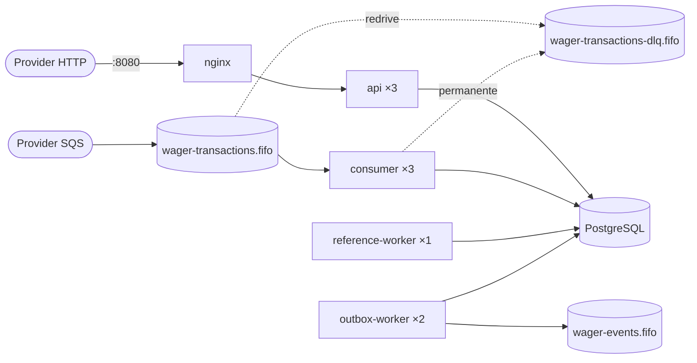

# Jungle Wagering Processor

[](https://github.com/DanielnetoDotCom/jungle-wagering-processor/actions/workflows/ci.yml)
[](https://github.com/DanielnetoDotCom/jungle-wagering-processor/actions/workflows/codeql.yml)

Serviço financeiro distribuído que processa transações de apostas (BET, WIN, LOSS, REFUND, ROLLBACK) recebidas de provedores de jogos por **HTTP** e por **SQS**. O foco é correção financeira sob concorrência, duplicação, entrega fora de ordem e falhas. Solução para o [desafio técnico da Jungle Gaming](https://github.com/junglegaming/backend-challenge).

> **Decisões e justificativas:** [ARCHITECTURE.md](ARCHITECTURE.md) · **Testes:** [docs/TEST_REPORT.md](docs/TEST_REPORT.md) · **Carga:** [docs/LOAD_TEST.md](docs/LOAD_TEST.md) · **CI/CD:** [docs/CI_CD.md](docs/CI_CD.md)

## Sumário

1. [O problema](#1-o-problema)
2. [Tecnologias](#2-tecnologias)
3. [Arquitetura](#3-arquitetura)
4. [Requisitos de ambiente](#4-requisitos-de-ambiente)
5. [Subir com Docker Compose](#5-subir-com-docker-compose)
6. [Confirmar as três APIs](#6-confirmar-as-três-apis)
7. [Executar os testes](#7-executar-os-testes)
8. [Migrations](#8-migrations)
9. [Endpoints (cURL)](#9-endpoints-curl)
10. [Enviar mensagens via SQS](#10-enviar-mensagens-via-sqs)
11. [Inspecionar Inbox, Outbox e DLQ](#11-inspecionar-inbox-outbox-e-dlq)
12. [Testar idempotência](#12-testar-idempotência)
13. [Reproduzir os cenários de concorrência](#13-reproduzir-os-cenários-de-concorrência)
14. [Reconciliação](#14-reconciliação)
15. [Observabilidade](#15-observabilidade)
16. [Limpar o ambiente](#16-limpar-o-ambiente)
17. [Variáveis de ambiente](#17-variáveis-de-ambiente)
18. [Troubleshooting](#18-troubleshooting)
19. [Limitações conhecidas](#19-limitações-conhecidas)
20. [Estrutura do repositório](#20-estrutura-do-repositório)

---

## 1. O problema

Provedores enviam operações de rodada (`BET → WIN | LOSS | REFUND | ROLLBACK`) com entrega *at-least-once*: a mesma operação pode chegar várias vezes, uma operação dependente pode chegar antes da referenciada, várias instâncias podem tocar a mesma wallet ao mesmo tempo, e processos podem morrer antes ou depois do commit. O sistema **não pode** duplicar créditos ou débitos, perder eventos confirmados nem permitir saldo negativo, e a solução precisa estar correta com **múltiplas instâncias**.

Como esta solução garante isso:

- **Lock pessimista por wallet** (`SELECT … FOR UPDATE`), sem lock global nem mutex em memória.
- **Idempotência persistente**: constraints únicas por provider, hash canônico do payload e replay que devolve o **saldo histórico**.
- **Uma transação SQL** para inbox, transação, saldo, ledger, snapshot da resposta e outbox.
- **Schema que se defende sozinho**: constraints, FKs compostas, índice único parcial, triggers de imutabilidade e de consistência ledger ↔ saldo, login de runtime sem `UPDATE`/`DELETE` no ledger.
- **Inbox** (deduplicação de mensagens, ack após o commit), **outbox** (claim com `SKIP LOCKED` + lease, *at-least-once*) e **worker de referências pendentes**.

## 2. Tecnologias

| | |
|---|---|
| Runtime / gerenciador / testes | **Bun 1.4.3** |
| Linguagem | **TypeScript 6** (modo estrito) |
| Framework | **NestJS 11** (Express) |
| Banco | **PostgreSQL 17** |
| ORM | **MikroORM 6** (`EntitySchema`, `em.transactional()`, `LockMode`, Migrator) |
| Mensageria | **AWS SQS** (AWS SDK v3) via **LocalStack 4.14** |
| Dinheiro | **decimal.js** + `NUMERIC(20,2)` |
| Validação | **zod 4** (contratos estritos compartilhados entre HTTP e SQS) |
| Observabilidade | **pino** (JSON), **@prometheus-io/client**, Prometheus + Grafana (perfil opcional) |
| Infra | Docker (multi-stage, não-root), Docker Compose, **nginx 1.28** |

Os motivos de cada versão estão em [ARCHITECTURE.md §10](ARCHITECTURE.md#10-escolha-de-versões).

## 3. Arquitetura

**DDD + Hexagonal + Monólito modular + Transactional Inbox/Outbox**: um código, vários processos, um PostgreSQL e imagem de migration separada.



| Camada | Pasta | Conteúdo |
|---|---|---|
| Domínio | `src/domain` | `Money`, `Wallet`, `WagerTransaction`, `WalletLedgerEntry`, `InboxMessage`, `OutboxMessage`, `IntegrationEvent<T>` + eventos, `WagerSettlementService` (todas as regras financeiras). Sem frameworks. |
| Aplicação | `src/application` | use cases, queries, portas (UnitOfWork, repositórios, Clock…), retry transacional |
| Infraestrutura | `src/infrastructure` | MikroORM/PostgreSQL, SQS, config validada, logs, métricas, health |
| Interfaces | `src/interfaces` | controllers HTTP, contratos zod, filtro de erros, consumidor SQS |
| Workers | `src/workers` | publisher do outbox, worker de referências pendentes |
| Composição | `src/bootstrap`, `src/entrypoints` | raiz de composição e um entrypoint por processo |

**Justificativa resumida.** As invariantes financeiras exigem atomicidade entre saldo, ledger, idempotência, inbox e outbox. Num banco único, isso é um COMMIT; com microsserviços, seria uma saga. A escala horizontal vem de **processos** independentes (3 APIs, 3 consumidores, 2 publishers), e a correção vem do **PostgreSQL** (locks + constraints), nunca da memória do processo nem da ordenação do SQS. Os detalhes estão nos 15 ADRs do [ARCHITECTURE.md](ARCHITECTURE.md).

## 4. Requisitos de ambiente

- **Docker** com **Docker Compose v2** (testado com Docker Desktop 29.7 / Compose v5.4 no Windows 11; funciona igual com Docker Engine no Linux).
- ~4 GB de RAM livres para os containers.
- Porta **8080** livre no host (ou defina `API_PUBLIC_PORT`).
- **Não é preciso instalar Bun, Node ou PostgreSQL no host**: build, testes, lint e scripts rodam em containers.

## 5. Subir com Docker Compose

```bash
git clone https://github.com/DanielnetoDotCom/jungle-wagering-processor.git
cd jungle-wagering-processor
docker compose up -d --build
```

O que acontece:

1. `postgres` e `localstack` sobem e ficam *healthy*;
2. o job `migrations` aplica as migrations (como owner do schema) e provisiona o login de runtime `wagering_service` (membro de `wagering_app`, sem `UPDATE`/`DELETE` no ledger);
3. o job `queue-bootstrap` cria de forma idempotente `wager-transactions.fifo`, `wager-transactions-dlq.fifo` (redrive após 5 recebimentos) e `wager-events.fifo`;
4. sobem **3 `api`**, **3 `consumer`**, **2 `outbox-worker`** e **1 `reference-worker`** (cada um *healthy* via `/health/ready`);
5. o `nginx` publica a API em `http://localhost:8080`.

Escala explícita (equivalente ao padrão):

```bash
docker compose up -d --build --scale api=3 --scale consumer=3 --scale outbox-worker=2
```

Estado dos serviços:

```bash
docker compose ps
```

Os valores padrão (senhas locais, LocalStack, porta) servem para rodar sem configuração. Para alterá-los, copie `.env.example` para `.env`.

## 6. Confirmar as três APIs

Cada resposta traz `X-Instance-Id` (instância que respondeu) e `X-Upstream-Addr` (réplica escolhida pelo nginx):

```bash
for i in 1 2 3 4 5 6; do curl -s -o /dev/null -D - http://localhost:8080/health/live | grep -i x-instance-id; done
# X-Instance-Id: 2a654298c4ce
# X-Instance-Id: 5e77156a6f6f
# X-Instance-Id: 235f22963d4d
# ... (round-robin entre as 3)
```

PowerShell:

```powershell
1..6 | ForEach-Object { (Invoke-WebRequest http://localhost:8080/health/live -UseBasicParsing).Headers['X-Instance-Id'] }
```

Readiness (PostgreSQL + SQS):

```bash
curl -s http://localhost:8080/health/ready
# {"status":"ready","checks":{"postgres":{"status":"up","latencyMs":3},"sqs":{"status":"up","latencyMs":6}},"instanceId":"..."}
```

**Tour guiado** de todos os fluxos (wallet, BET/WIN/LOSS/REFUND/ROLLBACK, idempotência, referência fora de ordem, SQS, ledger e reconciliação):

```bash
docker compose --profile tools run --rm toolbox bun run demo
```

## 7. Executar os testes

As suítes automatizadas usam **PostgreSQL e LocalStack reais**. Cada arquivo cria **seu próprio banco** (migrations reais + login de runtime) e **suas próprias filas**. Isso inclui o E2E, que compila e inicia três APIs, três consumers, dois publishers e um reference worker em processos próprios. O E2E não aceita `E2E_BASE_URL`/`E2E_DB_NAME`, não acessa as filas fixas da aplicação e não executa `PurgeQueue`. Para os testes, basta iniciar `docker compose up -d postgres localstack`. Os scripts `demo` e `test:load` operam sobre o stack configurado e criam dados nele.

```bash
# Tudo (unitários + integração + concorrência + falhas):
docker compose --profile tools run --rm --build toolbox bun run test

# Por suíte:
docker compose --profile tools run --rm toolbox bun run test:unit          # domínio, sem infraestrutura
docker compose --profile tools run --rm toolbox bun run test:integration   # PostgreSQL + LocalStack reais
docker compose --profile tools run --rm toolbox bun run test:concurrency   # paralelismo real, 3+ processos
docker compose --profile tools run --rm toolbox bun run test:fault         # SIGKILL em pontos exatos
docker compose --profile tools run --rm toolbox bun run test:e2e           # processos compilados, banco e filas próprios
docker compose --profile tools run --rm toolbox bun run test:load          # teste de carga (60s)

# Verificação completa: lint + typecheck + check:money + build + testes
docker compose --profile tools run --rm toolbox bun run verify
```

O `toolbox` é a imagem `dev` (código + dependências de desenvolvimento). Use `--build` depois de alterar o código. Resultados e cobertura de cada cenário obrigatório estão em [docs/TEST_REPORT.md](docs/TEST_REPORT.md).

O GitHub Actions executa qualidade, testes unitários com cobertura/JUnit, quatro suítes em jobs independentes com PostgreSQL/SQS reais e um smoke do Compose completo. Após aprovação desses checks, publica as imagens runtime e migrations no GHCR com tags por commit, digest, SBOM e provenance. CodeQL e Dependabot complementam as verificações. Consulte [docs/CI_CD.md](docs/CI_CD.md) para gatilhos, artefatos e reprodução local.

## 8. Migrations

Migrations versionadas e reversíveis em [`migrations/`](migrations/), classes MikroORM com SQL explícito:

| Migration | Conteúdo |
|---|---|
| `…0100CoreSchema` | `wallets`, `wager_transactions`, `wallet_ledger_entries`, constraints e índices |
| `…0200MessagingTables` | `inbox_messages`, `outbox_messages` |
| `…0300IntegrityTriggers` | imutabilidade, encadeamento do ledger, ledger ↔ saldo, máquina de estados, validação de referências |
| `…0400ApplicationRole` | papel `wagering_app` de menor privilégio |
| `…0500FinancialIntegrity` | rejeita valores não finitos, inserções retroativas que quebram o sucessor e divergência entre a cauda do ledger e a wallet |

```bash
docker compose run --rm migrations                                          # up + provisionamento (feito pelo `up -d`)
docker compose --profile tools run --rm toolbox bun run migration:status     # executadas / pendentes
docker compose --profile tools run --rm toolbox bun run migration:down       # reverte a última
docker compose --profile tools run --rm toolbox bun run migration:up         # reaplica
```

O teste `test/integration/migrations.test.ts` aplica tudo, reverte um passo, reverte **tudo** e reaplica, em PostgreSQL real.

A imagem `runtime` das APIs e workers contém apenas dependências de produção. O job `migrations` usa o target separado `migration-runtime`, que inclui o migrator e carrega as migrations somente nesse processo. A migration `…0500` valida o histórico existente antes de instalar as novas regras e aborta atomicamente se houver corrupção; ela não apaga nem corrige lançamentos. Sua execução exige os locks normais de DDL do PostgreSQL: programe a aplicação em um banco grande. Correções, patches de dependências e validação da auditoria estão em [docs/AUDIT_FIXES.md](docs/AUDIT_FIXES.md).

> `migration:down` reverte a última migration (`…0500`, as proteções adicionais de integridade). Reverter também `…0400` remove os grants do login runtime e impede os serviços de escrever até reaplicá-la. Para experimentar reversões sem afetar a aplicação, prefira os testes, que usam bancos descartáveis.

## 9. Endpoints (cURL)

Os exemplos usam bash (Linux, macOS, Git Bash ou WSL). No Windows PowerShell use `curl.exe` (o `curl` do PowerShell 5.1 é um alias de `Invoke-WebRequest`), ou rode `bun run demo` como na seção 6.

```bash
API=http://localhost:8080
PLAYER=0192f28f-5dc0-7d58-bdb2-814ad6a0f4a1
```

### Criar wallet — `POST /wallets`

```bash
curl -s -X POST $API/wallets -H 'content-type: application/json' \
  -d "{\"playerId\":\"$PLAYER\",\"initialBalance\":{\"amount\":\"1000.00\",\"currency\":\"BRL\"}}"
# 201 {"id":"<walletId>","playerId":"...","balance":{"amount":"1000.00","currency":"BRL"},"version":1,"createdAt":"..."}
WALLET=<walletId da resposta>
```

Saldo inicial > 0 gera, **na mesma transação SQL**, uma transação interna `OPENING` e o lançamento `CREDIT` (versão 1). A mesma combinação jogador+moeda devolve `409 WALLET_ALREADY_EXISTS` (com `details.walletId`).

### Consultar wallet — `GET /wallets/:walletId`

```bash
curl -s $API/wallets/$WALLET
# 200 {"id":"...","playerId":"...","balance":{"amount":"1000.00","currency":"BRL"},"version":1,"createdAt":"...","updatedAt":"..."}
```

### Submeter transação — `POST /wagering/transactions`

```bash
curl -s -i -X POST $API/wagering/transactions -H 'content-type: application/json' \
  -H 'Idempotency-Key: provider-a:transaction-123' \
  -d "{\"providerId\":\"provider-a\",\"externalTransactionId\":\"transaction-123\",\"playerId\":\"$PLAYER\",
       \"walletId\":\"$WALLET\",\"roundId\":\"round-987\",\"gameId\":\"fortune-chimp\",
       \"kind\":\"BET\",\"money\":{\"amount\":\"25.00\",\"currency\":\"BRL\"}}"
# HTTP/1.1 201 Created
# Location: /wagering/transactions/<transactionId>
# {"transactionId":"...","externalTransactionId":"transaction-123","kind":"BET","status":"PROCESSED",
#  "balance":{"amount":"975.00","currency":"BRL"},"walletVersion":2,"idempotentReplay":false}
```

Outros tipos (mesmo endpoint, nova chave e novo `externalTransactionId`):

```bash
tx() { # uso: tx <kind> <amount> <externalId> [referenceExternalId]
  local ref=""; [ -n "$4" ] && ref=",\"referenceExternalTransactionId\":\"$4\""
  curl -s -X POST $API/wagering/transactions -H 'content-type: application/json' -H "Idempotency-Key: provider-a:$3" \
    -d "{\"providerId\":\"provider-a\",\"externalTransactionId\":\"$3\",\"playerId\":\"$PLAYER\",\"walletId\":\"$WALLET\",
         \"roundId\":\"round-987\",\"gameId\":\"fortune-chimp\",\"kind\":\"$1\",\"money\":{\"amount\":\"$2\",\"currency\":\"BRL\"}$ref}"; echo; }

tx WIN 50.00 win-1 transaction-123          # 201, crédito (referência opcional à BET da rodada)
tx LOSS 0.00 loss-1 transaction-123         # 201 PROCESSED, saldo e versão inalterados, sem ledger
tx REFUND 25.00 refund-1 transaction-123    # 201, credita a BET (valor integral obrigatório)
tx ROLLBACK 25.00 rb-1 transaction-123      # 422 REFERENCE_ALREADY_REVERSED (a BET já foi revertida)
tx ROLLBACK 50.00 rb-2 win-1                # 201, debita o WIN (inverso da referência)
tx BET 99999.00 big-1                       # 422 INSUFFICIENT_FUNDS
tx REFUND 10.00 early-1 bet-not-sent-yet    # 202 PENDING_REFERENCE (resolvida pelo worker quando a BET chegar)
```

Tabela completa de status e `failureCode`: [ARCHITECTURE.md §2 e ADR-012](ARCHITECTURE.md#adr-012--http-e-erros). Em resumo: `201` primeira vez, `200` replay, `202` pendente, `400` inválido, `404` inexistente, `409` conflito de identidade/idempotência, `422` rejeição de negócio, `503` falha transitória (`retryable: true`). Todo erro tem `{code, message, correlationId, retryable, details?}`.

### Consultar transação

```bash
curl -s $API/wagering/transactions/<transactionId>
curl -s $API/providers/provider-a/wagering/transactions/transaction-123
```

### Ledger com paginação keyset — `GET /wallets/:walletId/ledger`

```bash
curl -s "$API/wallets/$WALLET/ledger?limit=2"
# {"walletId":"...","order":"asc","limit":2,"items":[{"walletVersion":1,"direction":"CREDIT",...},{...}],"nextCursor":"eyJ3Ij..."}
curl -s "$API/wallets/$WALLET/ledger?limit=2&cursor=<nextCursor>"
curl -s "$API/wallets/$WALLET/ledger?order=desc&limit=10"
```

O cursor é opaco e estável, ligado à wallet, e usa keyset por `wallet_version` (sem `OFFSET`).

### Reconciliação — `POST /wallets/:walletId/reconciliation`

Ver a seção [14](#14-reconciliação).

### Health

```bash
curl -s $API/health/live    # processo vivo (não depende do banco)
curl -s $API/health/ready   # PostgreSQL e SQS alcançáveis (timeout 2s); 503 se não
```

`/metrics` não é exposto pelo nginx; o Prometheus coleta direto de cada réplica na rede interna.

## 10. Enviar mensagens via SQS

Formato do desafio. `MessageGroupId` = `walletId` (ordenação por wallet):

```bash
MSG=$(cat <<EOF
{"messageId":"msg-123","type":"WagerTransactionRequested","occurredAt":"2026-07-29T15:00:00.000Z",
 "data":{"providerId":"provider-a","externalTransactionId":"transaction-456","idempotencyKey":"provider-a:transaction-456",
 "playerId":"$PLAYER","walletId":"$WALLET","roundId":"round-987","gameId":"fortune-chimp",
 "kind":"BET","money":{"amount":"10.00","currency":"BRL"}}}
EOF
)
docker compose exec -T localstack awslocal sqs send-message \
  --queue-url http://localhost:4566/000000000000/wager-transactions.fifo \
  --message-body "$MSG" --message-group-id "$WALLET" --message-deduplication-id "msg-123-a"

curl -s $API/providers/provider-a/wagering/transactions/transaction-456   # PROCESSED (channel SQS)
```

Envie de novo com outro `--message-deduplication-id`. O consumidor recebe a duplicata, o **inbox** a reconhece e a confirma sem novo efeito.

## 11. Inspecionar Inbox, Outbox e DLQ

```bash
PSQL="docker compose exec -T postgres psql -U wagering_owner -d wagering"

$PSQL -c "SELECT consumer_name, message_id, status, outcome, result_code, receive_count FROM inbox_messages ORDER BY received_at DESC LIMIT 10;"
$PSQL -c "SELECT status, count(*), max(attempts) FROM outbox_messages GROUP BY status;"
$PSQL -c "SELECT event_type, aggregate_id, attempts, published_at FROM outbox_messages ORDER BY seq DESC LIMIT 10;"
$PSQL -c "SELECT kind, status, failure_code, reference_attempts, next_attempt_at FROM wager_transactions WHERE status = 'PENDING_REFERENCE';"

# Mensagens na DLQ (motivo nos atributos deadLetterReason / errorCode):
docker compose exec -T localstack awslocal sqs receive-message \
  --queue-url http://localhost:4566/000000000000/wager-transactions-dlq.fifo \
  --attribute-names All --message-attribute-names All --max-number-of-messages 10

# Eventos publicados pelo outbox:
docker compose exec -T localstack awslocal sqs receive-message \
  --queue-url http://localhost:4566/000000000000/wager-events.fifo --max-number-of-messages 10
```

Para mandar uma mensagem inválida para a DLQ: envie `--message-body '{not json'`. Ela vai direto para a DLQ com `deadLetterReason=INVALID_MESSAGE`.

## 12. Testar idempotência

```bash
# 1) primeira vez -> 201
tx BET 20.00 idem-1
# 2) mesma chave + mesmo payload -> 200, idempotentReplay=true, MESMO saldo da primeira vez
tx BET 20.00 idem-1
# 3) mesma chave + payload diferente -> 409 IDEMPOTENCY_KEY_CONFLICT
curl -s -X POST $API/wagering/transactions -H 'content-type: application/json' -H 'Idempotency-Key: provider-a:idem-1' \
  -d "{\"providerId\":\"provider-a\",\"externalTransactionId\":\"idem-1\",\"playerId\":\"$PLAYER\",\"walletId\":\"$WALLET\",\"roundId\":\"round-987\",\"gameId\":\"fortune-chimp\",\"kind\":\"BET\",\"money\":{\"amount\":\"21.00\",\"currency\":\"BRL\"}}"
# 4) mesmo externalTransactionId com outra chave -> 409 DUPLICATE_EXTERNAL_TRANSACTION
```

O replay devolve o **saldo observado na operação original**, mesmo que a wallet tenha mudado depois. Algoritmo do `payloadHash`: [ARCHITECTURE.md ADR-006](ARCHITECTURE.md#adr-006--idempotência-persistente).

## 13. Reproduzir os cenários de concorrência

Cenário obrigatório (saldo 100.00, duas BETs de 80.00 simultâneas) pela API, em paralelo:

```bash
P=player-$(date +%s)-$RANDOM
W=$(curl -s -X POST $API/wallets -H 'content-type: application/json' \
  -d "{\"playerId\":\"$P\",\"initialBalance\":{\"amount\":\"100.00\",\"currency\":\"BRL\"}}" | sed -E 's/.*"id":"([^"]+)".*/\1/')
bet() { curl -s -o /dev/null -w "%{http_code}\n" -X POST $API/wagering/transactions -H 'content-type: application/json' -H "Idempotency-Key: k-$1" \
  -d "{\"providerId\":\"provider-a\",\"externalTransactionId\":\"$1\",\"playerId\":\"$P\",\"walletId\":\"$W\",\"roundId\":\"r\",\"gameId\":\"g\",\"kind\":\"BET\",\"money\":{\"amount\":\"80.00\",\"currency\":\"BRL\"}}"; }
bet a-$W & bet b-$W & wait          # -> um 201 e um 422
curl -s $API/wallets/$W             # balance 20.00, version 2
curl -s "$API/wallets/$W/ledger"    # OPENING CREDIT + exatamente um DEBIT
```

Versões automatizadas, com paralelismo real e verificação no banco:

| Cenário | Teste |
|---|---|
| 80 + 80 sobre 100 (25 wallets em paralelo; e entre 3 processos de API) | `test/concurrency/same-wallet-race.test.ts` |
| Mesma aposta 50× em paralelo (use case; 3 APIs; HTTP + 3 consumers) | `test/concurrency/idempotency-burst.test.ts` |
| Wallets distintas em paralelo + hot wallet, 3 APIs + 3 consumers | `test/concurrency/multi-instance-workload.test.ts` |
| Contenção, lock timeout, deadlock provocado, sem lock global | `test/concurrency/locks-and-deadlocks.test.ts` |
| Worker morto após commit / antes do ack; publisher morto; API morta; reinício | `test/fault-injection/crash-recovery.test.ts` |

```bash
docker compose --profile tools run --rm toolbox bun run test:concurrency
docker compose --profile tools run --rm toolbox bun run test:fault
```

## 14. Reconciliação

```bash
curl -s -X POST $API/wallets/$WALLET/reconciliation
# {"walletId":"...","storedBalance":{"amount":"975.00","currency":"BRL"},"calculatedBalance":{"amount":"975.00","currency":"BRL"},
#  "difference":{"amount":"0.00","currency":"BRL"},"consistent":true,"checkedEntries":42,
#  "walletVersion":42,"lastLedgerVersion":42,"checks":{"balanceMatches":true,"versionMatches":true,"chainIntact":true},"checkedAt":"..."}
```

A reconciliação recalcula o saldo pelo ledger imutável com aritmética `NUMERIC` exata, num snapshot `REPEATABLE READ` (sem falsos alarmes sob escrita concorrente). Também verifica a versão e a continuidade da cadeia. Divergências geram log `RECONCILIATION_DIVERGENCE`, a métrica `wagering_reconciliation_inconsistencies_total` e o alerta `ReconciliationDivergence`, e **nunca** são corrigidas automaticamente.

## 15. Observabilidade

```bash
docker compose --profile observability up -d
```

- **Prometheus**: http://localhost:9090. Descobre cada réplica via DNS (`api`, `consumer`, `outbox-worker`, `reference-worker`). Regras de alerta em `infra/monitoring/prometheus/alerts.yml`.
- **Grafana**: http://localhost:3001 (usuário `admin`, senha `local-dev-grafana` ou `GRAFANA_ADMIN_PASSWORD`). Dashboard **Wagering / Wagering Processor**.
- **Logs** JSON em todos os serviços: `docker compose logs -f api consumer`. Filtre por `correlationId`, `messageId`, `transactionId`, `walletId` ou `providerId`.

Principais métricas: `wagering_transactions_total{kind,status,channel}`, `wagering_idempotent_replays_total`, `wagering_idempotency_conflicts_total`, `wagering_inbox_duplicates_total`, `wagering_db_retries_total{reason}`, `wagering_wallet_lock_contention_total`, `wagering_wallet_lock_wait_seconds`, `wagering_lock_timeouts_total`, `wagering_deadlocks_total`, `wagering_processing_duration_seconds`, `wagering_outbox_lag_seconds`, `wagering_outbox_pending`, `wagering_outbox_dead`, `wagering_pending_reference_lag_seconds`, `wagering_sqs_dlq_depth`, `wagering_sqs_consumer_paused` (1 enquanto o consumidor espera o banco voltar), `wagering_sqs_message_retries_total`, `wagering_sqs_messages_dead_lettered_total`, `wagering_reconciliation_inconsistencies_total`.

## 16. Limpar o ambiente

```bash
docker compose --profile observability --profile tools down   # para e remove containers e redes; MANTÉM os dados
docker compose up -d                                           # volta com os mesmos dados
```

> ⚠️ `docker compose down -v` **apaga os volumes** (`pgdata`, Prometheus, Grafana): todas as wallets, transações e o ledger. Use apenas quando quiser recomeçar do zero. As suítes de integração, concorrência, falhas e E2E usam bancos descartáveis `wagering_test_*` e filas próprias, removidos ao final. A demo, o teste de carga e o smoke do Compose criam dados no stack explicitamente configurado.

## 17. Variáveis de ambiente

Validadas na inicialização (`src/infrastructure/configuration/config.ts`): configuração inválida impede o processo de subir. As senhas não têm valor padrão no código; os padrões locais ficam só no `docker-compose.yml`/`.env.example`.

| Variável | Padrão | Descrição |
|---|---|---|
| `API_PUBLIC_PORT` | `8080` | porta do nginx no host (Compose) |
| `DB_HOST` / `DB_PORT` / `DB_NAME` | — / `5432` / — | PostgreSQL |
| `DB_USER` / `DB_PASSWORD` | — | login de runtime (`wagering_service` no Compose) |
| `DB_MIGRATION_USER` / `DB_MIGRATION_PASSWORD` | — | owner usado por `migrate.ts` (senão usa `DB_USER`) |
| `DB_APP_USER` / `DB_APP_PASSWORD` | — | login provisionado pelo job de migrations |
| `DB_POOL_MAX` | `10` | conexões por processo (Compose: api 10, consumer 5, workers 3) |
| `DB_LOCK_TIMEOUT_MS` / `DB_STATEMENT_TIMEOUT_MS` / `DB_IDLE_IN_TRANSACTION_TIMEOUT_MS` | `5000` / `15000` / `30000` | limites por sessão |
| `TX_RETRY_MAX_ATTEMPTS` / `TX_RETRY_BASE_MS` / `TX_RETRY_MAX_MS` | `4` / `20` / `500` | retry de deadlock/serialização/lock timeout |
| `AWS_REGION` / `AWS_ENDPOINT_URL` | `us-east-1` / — | SQS (LocalStack no Compose) |
| `SQS_TRANSACTIONS_QUEUE` / `SQS_TRANSACTIONS_DLQ` / `SQS_EVENTS_QUEUE` | `wager-transactions.fifo` / `…-dlq.fifo` / `wager-events.fifo` | filas |
| `SQS_WAIT_TIME_SECONDS` / `SQS_VISIBILITY_TIMEOUT_SECONDS` / `SQS_MAX_RECEIVE_COUNT` | `20` / `30` / `5` | long poll, visibilidade, tentativas antes da DLQ |
| `SQS_RETRY_BASE_MS` / `SQS_RETRY_MAX_MS` | `1000` / `60000` | backoff de mensagens com erro transitório |
| `OUTBOX_BATCH_SIZE` / `OUTBOX_POLL_INTERVAL_MS` / `OUTBOX_LEASE_MS` / `OUTBOX_MAX_ATTEMPTS` | `50` / `250` / `30000` / `15` | publisher |
| `REFERENCE_RETRY_INITIAL_MS` / `REFERENCE_RETRY_MAX_MS` / `REFERENCE_MAX_ATTEMPTS` / `REFERENCE_TTL_MS` | `2000` / `300000` / `10` / `3600000` | referências pendentes |
| `ACCEPTED_CURRENCIES` | `BRL` | moedas aceitas na criação de wallets |
| `LOG_LEVEL` / `TEST_LOG_LEVEL` | `info` / `silent` | logs dos serviços / do toolbox |
| `AUTH_MODE` | `none` | ponto de extensão de autenticação (ADR-015) |
| `LOCALSTACK_IMAGE` / `LOCALSTACK_AUTH_TOKEN` | `localstack/localstack:4.14.0` / — | ver Troubleshooting |
| `FAULT_INJECTION_ENABLED` / `FAULT_INJECTION` | `false` / — | **somente testes**; recusado com `NODE_ENV=production` |

## 18. Troubleshooting

| Sintoma | Causa / solução |
|---|---|
| `Bind for 0.0.0.0:8080 failed: port is already allocated` | outra aplicação usa a 8080: `API_PUBLIC_PORT=18080 docker compose up -d` (ou defina no `.env`) |
| LocalStack encerra com `License activation failed` | imagens `localstack/localstack:2026.x`/`latest` exigem token. O padrão é `4.14.0` (sem token); para outra versão, defina `LOCALSTACK_IMAGE` e `LOCALSTACK_AUTH_TOKEN` |
| `curl` no PowerShell se comporta diferente | no Windows PowerShell 5.1 `curl` é `Invoke-WebRequest`: use `curl.exe`, Git Bash/WSL, ou `docker compose --profile tools run --rm toolbox bun run demo` |
| API ou worker não fica *healthy* | `docker compose logs api` / `docker compose logs migrations`. O readiness exige PostgreSQL **e** SQS: confira se `queue-bootstrap` terminou com código 0 |
| Filas sumiram depois de reiniciar o LocalStack | a edição community não persiste estado: `docker compose up -d queue-bootstrap` (ou `docker compose up -d`) recria as filas |
| Testes falham com `ECONNREFUSED`/`Stack not ready` | suba o stack antes (`docker compose up -d --build`) e use o `toolbox`, que está nas redes internas |
| Testes rodam código antigo | o `toolbox` copia o código no build: `docker compose --profile tools run --rm --build toolbox …` |
| `503 DATABASE_UNAVAILABLE` / `LOCK_TIMEOUT` | condição transitória (`retryable: true`); repetir com a mesma `Idempotency-Key` é seguro |
| Scripts quebrando após clonar no Windows | `.gitattributes` força LF; preserve alterações locais e confira a configuração de finais de linha. Um clone novo em outra pasta permite validar sem descartar o trabalho atual. |
| Primeiro `up --build` demorado | download de imagens e dependências; as execuções seguintes usam o cache do BuildKit |

## 19. Limitações conhecidas

Resumo; a lista completa e os motivos estão em [ARCHITECTURE.md §9](ARCHITECTURE.md#9-limitações-conhecidas).

- LocalStack community não persiste filas/mensagens entre reinícios.
- Ordenação de eventos por wallet é *best effort* entre publishers concorrentes (os eventos carregam `walletVersion`); a entrega é *at-least-once*, e os consumidores devem deduplicar por `eventId`.
- Hot wallets têm throughput limitado pela serialização (custo medido em [docs/LOAD_TEST.md](docs/LOAD_TEST.md)).
- Autenticação não implementada: há um ponto de extensão (`ProviderIdentityResolver`) e um adaptador no-op que **não é seguro para produção**.
- Sem retenção/arquivamento de inbox/outbox, sem reconciliação agendada, sem OpenTelemetry.
- Interpretação conservadora: no máximo **uma** reversão (REFUND ou ROLLBACK) bem-sucedida por transação.

## 20. Estrutura do repositório

```
src/
  domain/          money, wallet, ledger, wagering (regras + máquina de estados), messaging, events, errors
  application/     use-cases, queries, ports, commands, services (hash, retry, settlement recorder), errors, views
  infrastructure/  configuration, persistence/mikroorm, messaging/sqs, logging, metrics, health, runtime
  interfaces/      http (controllers, auth, presenters, support), consumers, contracts (zod)
  workers/         outbox, pending-reference
  bootstrap/       composition root (core.ts) e módulos Nest
  entrypoints/     api, consumer, outbox-worker, reference-worker, migrate, bootstrap-queues
  shared/          canonical-json, backoff, sleep
migrations/        migrations versionadas (up/down)
infra/             docker (Dockerfile), nginx, monitoring (Prometheus, Grafana)
test/              unit, integration, concurrency, fault-injection, e2e, support
scripts/           demo, load-test, verification (check-money, compose-smoke)
docs/              TEST_REPORT.md, LOAD_TEST.md, AUDIT_FIXES.md, CI_CD.md
.github/           workflows de CI, CodeQL, publicação de imagens e Dependabot
```

Scripts (`package.json`): `dev`, `build`, `start`, `lint`, `format`, `typecheck`, `check:money`, `test`, `test:unit`, `test:integration`, `test:concurrency`, `test:fault`, `test:e2e`, `test:load`, `migration:up|down|status`, `queues:bootstrap`, `demo`, `verify`.

Desenvolvimento fora do Docker (opcional, exige Bun no host): `docker compose -f docker-compose.yml -f docker-compose.dev.yml up -d postgres localstack migrations queue-bootstrap`, depois descomente o bloco *Host development* do `.env` e rode `bun install && bun run dev`. Este modo não foi exercitado no ambiente de validação, que não tinha Bun no host.
